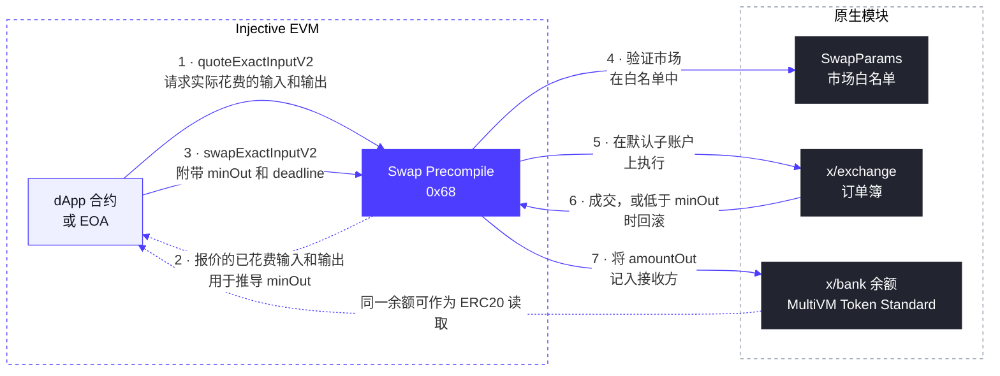

Injective 的 Swap Precompile 在 `0x0000000000000000000000000000000000000068` 处向 EVM 应用开放原生现货交易所。使用它可以读取订单簿报价、设置最低输出和截止时间，并在一次调用中执行兑换。

本页介绍接口、市场白名单、代币单位，以及一个使用 viem 的完整 TypeScript 集成。示例以测试网上的 INJ 和 Circle USDC 为例；同样的流程也适用于其他已激活、在白名单中且支持相应代币方向的市场。

<Info>
  TypeScript 演练在测试网上使用 V2 exact-input API。在提交交易之前，
  请检查目标网络上已部署的 API、支持的方向、市场白名单
  以及可用流动性。
</Info>

## 工作原理 {#how-it-works}

1. 选择网络和受支持的现货市场。
2. 解析输入代币，并以其原生整数单位表示数量。
3. 读取报价，然后推导出最低输出和截止时间。
4. 从有资金的调用方模拟兑换，提交交易，并等待成功的回执。



报价读取当前订单簿，不会改变状态。执行时会在调用方的默认子账户上下一个原子现货市价单，并将输出记入接收方。如果最低输出或截止时间检查失败，兑换的状态变更会回滚；但交易 gas 仍可能被收取。

V2 方法同时返回 `amountInSpent` 和 `amountOut`。`amountIn` 是输入预算：流动性不足或数量 tick 可能导致其中一部分未被花费。兑换不会为剩余部分创建挂单。`minOut` 保护成交的绝对输出；它不要求消耗全部输入预算。请将预估的花费金额与预期输出一起展示。

在执行之前，报价可能会随着订单和账户特定费用的变化而改变。执行时的最低输出和截止时间才是具有约束力的条件。

## Swap Precompile 接口 {#swap-precompile-interface}

当你的应用需要报告实际的输入消耗时，请使用 V2 exact-input 方法。该接口还提供 V1 exact-input 和 exact-output 方法；请检查已部署节点是否支持。

```solidity
interface ISwapModule {
    /// Quote the input consumed and output received for an input budget.
    function quoteExactInputV2(
        address tokenIn,
        string calldata marketId,
        uint256 amountIn
    ) external view returns (uint256 amountInSpent, uint256 amountOut);

    /// Execute within minOut and deadline; return spent input and output.
    function swapExactInputV2(
        address tokenIn,
        string calldata marketId,
        uint256 amountIn,
        uint256 minOut,
        address recipient,
        uint256 deadline
    ) external returns (uint256 amountInSpent, uint256 amountOut);

    /// Legacy exact-input quote; returns only output.
    function quoteExactInputV1(
        address tokenIn,
        string calldata marketId,
        uint256 amountIn
    ) external view returns (uint256 amountOut);

    /// Legacy exact-input swap; returns only output.
    function swapExactInputV1(
        address tokenIn,
        string calldata marketId,
        uint256 amountIn,
        uint256 minOut,
        address recipient,
        uint256 deadline
    ) external returns (uint256 amountOut);

    /// Quote the input required to receive the target output.
    function quoteExactOutputV1(
        address tokenOut,
        string calldata marketId,
        uint256 amountOut
    ) external view returns (uint256 amountIn);

    /// Receive at least amountOut while spending at most maxAmountIn.
    function swapExactOutputV1(
        address tokenOut,
        string calldata marketId,
        uint256 amountOut,
        uint256 maxAmountIn,
        address recipient,
        uint256 deadline
    ) external returns (uint256 amountInSpent, uint256 amountOutDelivered);
}
```

参数说明：

- `marketId` 是 ABI `string` 类型，尽管它包含一个以 `0x` 为前缀的 32 字节哈希。它用于选择订单簿。
- `tokenIn` 决定输入方向：使用市场的 base 资产时卖出 base 换取 quote，使用 quote 资产时买入 base。原生 INJ 使用零地址；其他受支持的资产使用其 ERC20 地址。
- `tokenOut` 为 exact-output 方法选择要接收的资产。
- 数量使用各代币的原生整数单位。例如，`parseUnits('10', 6)` 表示 10 USDC，`parseUnits('0.1', 18)` 表示 0.1 INJ。请始终使用十进制字符串和 bigint。
- `minOut` 是以输出代币单位表示的最低可接受输出；`maxAmountIn` 以输入代币单位限制输入上限。
- `recipient` 接收输出。对于直接的 EOA 调用，precompile 会从调用方现有的 bank/MTS 余额中扣款；无需向 precompile 授予 ERC20 allowance。
- `deadline` 是以秒为单位的 Unix 时间戳。请省略交易的 `value`，包括卖出 INJ 时也一样：非零 value 会导致回滚。

V1 exact-input 方法只返回输出。V2 还会返回已花费的输入，也是本指南的重点。`quoteExactOutputV1` 和 `swapExactOutputV1` 接收输出代币：它们可以表达诸如“以有上限的 USDC 输入至少获得指定数量的 INJ”这样的目标。Tick 舍入可能使实际交付略多于目标。在采用这些方法之前，请检查已部署节点是否支持。

这些 ABI 方法上的 V1 和 V2 后缀表示 API 版本。它们与 exchange 模块旧版的 v1beta1 和当前的 v2 protobuf 类型无关。

## 市场白名单 {#market-allowlist}

可兑换的市场由 `SwapParams` 管理，它是 exchange 模块参数中的一个启用标志加一个市场白名单。在不在白名单中的市场上调用 precompile 会回滚，并返回：

```text
market <id> is not allowlisted for swaps: invalid swap route
```

### 查看当前白名单 {#checking-the-current-allowlist}

实时白名单是 exchange 模块 v2 参数的一部分。请使用目标网络的 REST 端点；以下命令查询主网：

```bash
curl -s https://sentry.lcd.injective.network/injective/exchange/v2/exchangeParams \
  | jq '.params.swap_params'
```

对于测试网，请将主机替换为 `https://k8s.testnet.lcd.injective.network`。同一查询的 `.params.exchange_admins` 字段列出了有权更新白名单的地址。

### 申请添加市场 {#requesting-a-market}

如果你正在基于 swap precompile 进行构建并需要将某个市场加入白名单，请在 [Injective Discord](https://discord.gg/injective) 的 `#developers` 频道中提供现货市场 ID，或联系你的 Injective 合作伙伴。活跃现货市场的市场 ID 可在 `/injective/exchange/v2/spot/markets?status=Active` 中查询。

### 更新白名单（exchange 管理员） {#updating-the-allowlist-exchange-admins}

`MsgUpdateSwapParams` 可由治理权限账户或 `exchange_admins` 参数中的任何地址调用。由管理员发送时，它会立即生效，无需治理投票。

该消息会**完全替换** swap 参数组。请始终包含所有应保留在白名单中的市场，并保持 `enabled: true`，因为遗漏现有市场会将其移除，而遗漏该标志会暂停所有兑换。

```json
{
  "body": {
    "messages": [
      {
        "@type": "/injective.exchange.v2.MsgUpdateSwapParams",
        "sender": "<admin inj1... address>",
        "swap_params": {
          "enabled": true,
          "allowed_markets": ["0x<existing market id>", "0x<new market id>"]
        }
      }
    ]
  },
  "auth_info": {
    "fee": {
      "amount": [{ "denom": "inj", "amount": "200000000000000" }],
      "gas_limit": "400000"
    }
  }
}
```

使用管理员密钥通过 `injectived tx sign` 和 `injectived tx broadcast` 对交易文档进行签名和广播。

## 报价与兑换模式 {#quote-and-swap-pattern}

```solidity
(uint256 quotedSpent, uint256 quotedOut) = SWAP.quoteExactInputV2(
    tokenIn, marketId, amountIn
);
uint256 minOut = (quotedOut * (10_000 - slippageBps)) / 10_000;
(uint256 amountInSpent, uint256 amountOut) = SWAP.swapExactInputV2(
    tokenIn, marketId, amountIn, minOut, recipient, block.timestamp + 120
);
```

## TypeScript 演练 {#typescript-walkthrough}

以下示例在测试网上对 INJ/USDC 兑换的两个方向进行报价和模拟。只有在使用 `--send` 运行时才会发送交易。

### 配置示例 {#configure-the-worked-example}

| 设置            | 值                                                                   |
| --------------- | -------------------------------------------------------------------- |
| EVM chain ID    | `1439`                                                               |
| 原生 chain ID   | `injective-888`                                                      |
| EVM RPC         | `https://k8s.testnet.json-rpc.injective.network/`                    |
| Chain REST API  | `https://k8s.testnet.lcd.injective.network`                          |
| Swap precompile | `0x0000000000000000000000000000000000000068`                         |
| 现货市场 ID     | `0x0f6ee483a7f7f633fe6e3f03d34e01e129b5a5023eb7b0fe1e8a56e5ac8779a6` |
| Base 资产       | 原生 INJ，18 位小数                                                  |
| Quote denom     | `erc20:0x0C382e685bbeeFE5d3d9C29e29E341fEE8E84C5d`                   |
| Quote 小数位数  | 6                                                                    |
| 数量 tick       | `0.0001` INJ                                                         |

[EVM 网络参考](/cn/developers-evm/network-information)提供了 RPC 和 chain ID。查看[市场](https://k8s.testnet.lcd.injective.network/injective/exchange/v2/spot/markets/0x0f6ee483a7f7f633fe6e3f03d34e01e129b5a5023eb7b0fe1e8a56e5ac8779a6)和 [swap 参数](https://k8s.testnet.lcd.injective.network/injective/exchange/v2/exchangeParams)以了解当前配置。

[Circle 的部署参考](https://developers.circle.com/stablecoins/usdc-contract-addresses)确认了代币地址。[资产页面](https://testnet.injscan.com/asset/erc20:0x0C382e685bbeeFE5d3d9C29e29E341fEE8E84C5d/)标明了对应的 bank denom。

### 理解示例调用 {#understand-the-example-call}

precompile 会将 EVM 调用转换为 Injective exchange 模块中的原子现货市价单。在 INJ/USDC 示例中，输入代币决定方向：

| 操作     | 输入代币                  | 输入数量             | 输出        |
| -------- | ------------------------- | -------------------- | ----------- |
| 买入 INJ | 市场 USDC ERC20 地址      | 6 位小数的 USDC      | 原生 INJ    |
| 卖出 INJ | `zeroAddress`             | 18 位小数的 INJ      | 市场 USDC   |

Circle USDC 通过 MultiVM Token Standard 暴露账户的 bank 余额。其原生 bank denom 会自动派生为 `erc20:<checksummed token address>`；无需存储代币对注册。请在账户中保留 INJ 以支付交易 gas，包括用 USDC 买入 INJ 时。

### 解析示例代币 {#resolve-the-example-token}

在本示例中，输入代币决定调用是用 USDC 买入 INJ，还是卖出 INJ 换取 USDC。代币解析结果必须与所选市场的 base 和 quote denom 一致。

无需列出所有代币对即可查询 denom 解析：

```bash
curl --get 'https://k8s.testnet.lcd.injective.network/injective/erc20/v1beta1/token_pair_by_erc20_address' \
  --data-urlencode 'erc20_address=0x0C382e685bbeeFE5d3d9C29e29E341fEE8E84C5d'
```

响应会将该 ERC20 地址与 `erc20:0x0C382e685bbeeFE5d3d9C29e29E341fEE8E84C5d` 关联起来。对于 EVM 原生 MTS 代币，此查询无需存储的代币对即可推导出对应关系。原生 TokenFactory denom 遵循不同的注册路径；请参阅 [ERC20 module 参考](/cn/developers-evm/erc20-module)。

从 [Injective 水龙头](https://testnet.faucet.injective.network/)获取 INJ，从 [Circle 水龙头](https://faucet.circle.com/)获取 USDC，为专用的测试网 EVM 账户充值。买入时，订单簿需要有挂单的 INJ 卖单；卖出时，需要有使用这种 USDC 充值的挂单买单。卖出报价成功本身并不能证明存在买方流动性。测试网订单簿价格可能是任意的；请勿将教程市场视为 INJ 真实价格的参考。

### 创建项目 {#create-the-project}

使用 Node.js 22 或更高版本。创建项目目录及其源码文件夹，然后将以下文件保存到其中。本地 `.env` 必须排除在版本控制之外。

```bash
mkdir -p swap-precompile-guide/src
cd swap-precompile-guide
```

`package.json`:

```json
{
  "name": "injective-testnet-swap-guide",
  "version": "1.0.0",
  "private": true,
  "type": "module",
  "engines": {
    "node": ">=22"
  },
  "scripts": {
    "build": "tsc",
    "swap": "node --env-file-if-exists=.env dist/swap.js",
    "format": "prettier --write .",
    "format:check": "prettier --check ."
  },
  "dependencies": {
    "viem": "2.49.2"
  },
  "devDependencies": {
    "@types/node": "25.8.0",
    "typescript": "5.8.3",
    "prettier": "3.7.4"
  }
}
```

`tsconfig.json`:

```json
{
  "compilerOptions": {
    "target": "ES2022",
    "module": "NodeNext",
    "moduleResolution": "NodeNext",
    "strict": true,
    "outDir": "dist",
    "skipLibCheck": true
  },
  "include": ["src/**/*.ts"]
}
```

将格式化设置保存为 `.prettierrc.js`：

```javascript
export default {
  endOfLine: 'auto',
  printWidth: 80,
  semi: false,
  singleQuote: true,
  trailingComma: 'none'
}
```

将排除项保存为 `.prettierignore`：

```text
node_modules/
dist/
verification-live.txt
```

运行 `npm run format` 以应用项目的格式化规则，或运行 `npm run format:check` 进行检查。

`.gitignore`:

```text
.env
node_modules/
dist/
```

`.env`:

```dotenv
RPC_URL=https://k8s.testnet.json-rpc.injective.network/
LCD_URL=https://k8s.testnet.lcd.injective.network
MARKET_ID=0x0f6ee483a7f7f633fe6e3f03d34e01e129b5a5023eb7b0fe1e8a56e5ac8779a6
SLIPPAGE_BPS=50
# Set only for --simulate or --send, using a dedicated testnet account.
# PRIVATE_KEY=0x...
```

添加 TypeScript 文件后进行安装和编译：

```bash
npm install
npm run build
```

### 定义网络和 ABI {#define-the-network-and-abi}

保存为 `src/config.ts`。这个精简 ABI 包含用于诊断的 V1，以及用于报告实际输入消耗的兑换的 V2。

```typescript
import { http, parseAbi, defineChain, createPublicClient } from 'viem'

export const RPC_URL =
  process.env.RPC_URL ?? 'https://k8s.testnet.json-rpc.injective.network/'
export const LCD_URL = (
  process.env.LCD_URL ?? 'https://k8s.testnet.lcd.injective.network'
).replace(/\/$/, '')
export const MARKET_ID =
  process.env.MARKET_ID ??
  '0x0f6ee483a7f7f633fe6e3f03d34e01e129b5a5023eb7b0fe1e8a56e5ac8779a6'
export const SWAP = '0x0000000000000000000000000000000000000068' as const
export const USDC_ADDRESS =
  '0x0C382e685bbeeFE5d3d9C29e29E341fEE8E84C5d' as const
export const USDC_DENOM = `erc20:${USDC_ADDRESS}`

export const chain = defineChain({
  id: 1439,
  name: 'Injective EVM Testnet',
  nativeCurrency: { name: 'Injective', symbol: 'INJ', decimals: 18 },
  rpcUrls: { default: { http: [RPC_URL] } },
  blockExplorers: {
    default: {
      name: 'Blockscout',
      url: 'https://testnet.blockscout.injective.network'
    }
  },
  testnet: true
})
export const client = createPublicClient({ chain, transport: http(RPC_URL) })
export const swapAbi = parseAbi([
  'function quoteExactInputV1(address tokenIn, string marketId, uint256 amountIn) view returns (uint256 amountOut)',
  'function quoteExactInputV2(address tokenIn, string marketId, uint256 amountIn) view returns (uint256 amountInSpent, uint256 amountOut)',
  'function swapExactInputV2(address tokenIn, string marketId, uint256 amountIn, uint256 minOut, address recipient, uint256 deadline) returns (uint256 amountInSpent, uint256 amountOut)'
])
export const tokenAbi = parseAbi([
  'function decimals() view returns (uint8)',
  'function balanceOf(address owner) view returns (uint256)'
])

export type Market = {
  ticker: string
  status: string
  market_id: string
  base_denom: string
  quote_denom: string
  min_notional: string
  base_decimals: number
  quote_decimals: number
  min_quantity_tick_size: string
}
export type SwapParams = { enabled: boolean; allowed_markets: string[] }
export type TokenPair = { bank_denom: string; erc20_address: string }

export async function lcd<T>(path: string): Promise<T> {
  const response = await fetch(`${LCD_URL}${path}`, {
    signal: AbortSignal.timeout(20_000)
  })
  if (!response.ok)
    throw new Error(`LCD ${response.status}: ${await response.text()}`)

  return (await response.json()) as T
}

export async function inspect() {
  if (!/^0x[0-9a-fA-F]{64}$/.test(MARKET_ID))
    throw new Error('MARKET_ID must be a 0x-prefixed 32-byte hash string')
  const [chainId, node, params, market, pair] = await Promise.all([
    client.getChainId(),
    lcd<{ default_node_info: { network: string } }>(
      '/cosmos/base/tendermint/v1beta1/node_info'
    ),
    lcd<{ params: { swap_params: SwapParams; exchange_admins: string[] } }>(
      '/injective/exchange/v2/exchangeParams'
    ),
    lcd<{ market: null | Market }>(
      `/injective/exchange/v2/spot/markets/${MARKET_ID}`
    ),
    lcd<{ token_pair: null | TokenPair }>(
      `/injective/erc20/v1beta1/token_pair_by_denom?bank_denom=${encodeURIComponent(USDC_DENOM)}`
    )
  ])
  if (chainId !== 1439 || node.default_node_info.network !== 'injective-888') {
    throw new Error(
      'RPC and LCD must both target Injective testnet (1439 / injective-888)'
    )
  }

  return {
    chainId,
    nativeChainId: node.default_node_info.network,
    swap_params: params.params.swap_params,
    exchange_admins: params.params.exchange_admins,
    market: market.market,
    tokenPair: pair.token_pair
  }
}
```

### 实现报价、模拟和执行 {#implement-quote-simulation-and-execution}

保存为 `src/swap.ts`。默认模式读取报价。`--simulate` 使用指定账户检查执行情况，但不提交交易。`--send` 会签名并广播一笔真实的测试网交易。

```typescript
import { privateKeyToAccount } from 'viem/accounts'
import {
  http,
  getAddress,
  parseUnits,
  formatUnits,
  zeroAddress,
  createWalletClient
} from 'viem'
import {
  SWAP,
  chain,
  client,
  inspect,
  swapAbi,
  tokenAbi,
  MARKET_ID,
  USDC_DENOM,
  USDC_ADDRESS
} from './config.js'

async function main() {
  const [side, amount, mode = '--quote'] = process.argv.slice(2)

  if (
    !['buy', 'sell'].includes(side) ||
    !amount ||
    !['--send', '--quote', '--simulate'].includes(mode)
  ) {
    throw new Error(
      'Usage: npm run swap -- buy|sell AMOUNT [--quote|--simulate|--send]'
    )
  }

  const state = await inspect()
  const market = state.market

  if (
    !market ||
    market.status !== 'Active' ||
    market.base_denom !== 'inj' ||
    market.quote_denom !== USDC_DENOM
  ) {
    throw new Error(
      'Expected the active INJ / Circle USDC testnet market; do not select a market by ticker alone.'
    )
  }

  if (
    !state.swap_params.enabled ||
    !state.swap_params.allowed_markets.some(
      (id) => id.toLowerCase() === MARKET_ID.toLowerCase()
    )
  ) {
    throw new Error(
      'Swaps disabled or this market is not allowlisted. An exchange admin must update SwapParams.'
    )
  }
  if (!state.tokenPair) {
    throw new Error(
      'Circle USDC bank denom could not be resolved on this network'
    )
  }

  const usdc = getAddress(state.tokenPair.erc20_address)

  if (usdc !== getAddress(USDC_ADDRESS)) {
    throw new Error('Resolved token is not the expected Circle USDC deployment')
  }

  const decimals = await client.readContract({
    address: usdc,
    abi: tokenAbi,
    functionName: 'decimals'
  })

  if (
    decimals !== 6 ||
    Number(market.quote_decimals) !== 6 ||
    Number(market.base_decimals) !== 18
  ) {
    throw new Error('Unexpected token or market decimals')
  }

  const buying = side === 'buy'
  const tokenIn = buying ? usdc : zeroAddress
  const inputDecimals = buying ? 6 : 18
  const outputDecimals = buying ? 18 : 6
  const inputSymbol = buying ? 'USDC' : 'INJ'
  const outputSymbol = buying ? 'INJ' : 'USDC'

  // Reject excess precision instead of silently rounding user input.
  if (
    !/^\d+(\.\d+)?$/.test(amount) ||
    (amount.split('.')[1]?.length ?? 0) > inputDecimals
  ) {
    throw new Error(
      `AMOUNT must be a positive decimal string with at most ${inputDecimals} fractional digits`
    )
  }

  const amountIn = parseUnits(amount, inputDecimals)

  if (amountIn <= 0n) {
    throw new Error('AMOUNT must be positive')
  }

  const bps = Number(process.env.SLIPPAGE_BPS ?? '50')

  if (!Number.isInteger(bps) || bps < 0 || bps >= 10_000) {
    throw new Error('SLIPPAGE_BPS must be an integer from 0 to 9999')
  }

  const [quotedSpent, quotedOut] = await client.readContract({
    address: SWAP,
    abi: swapAbi,
    functionName: 'quoteExactInputV2',
    args: [tokenIn, MARKET_ID, amountIn]
  })

  const minOut = (quotedOut * BigInt(10_000 - bps)) / 10_000n

  if (quotedSpent <= 0n || quotedOut <= 0n || minOut <= 0n) {
    throw new Error('Quote is too small for a protected swap')
  }

  console.log({
    inputBudget: `${formatUnits(amountIn, inputDecimals)} ${inputSymbol}`,
    estimatedInputSpent: `${formatUnits(quotedSpent, inputDecimals)} ${inputSymbol}`,
    estimatedOutput: `${formatUnits(quotedOut, outputDecimals)} ${outputSymbol}`,
    minimumOutput: `${formatUnits(minOut, outputDecimals)} ${outputSymbol}`
  })

  if (mode === '--quote') {
    return
  }

  const privateKey = process.env.PRIVATE_KEY

  if (!privateKey || !/^0x[0-9a-fA-F]{64}$/.test(privateKey)) {
    throw new Error(
      'Set PRIVATE_KEY to a dedicated testnet account key in your local .env'
    )
  }

  const account = privateKeyToAccount(privateKey as `0x${string}`)
  const wallet = createWalletClient({
    chain,
    account,
    transport: http(chain.rpcUrls.default.http[0])
  })

  const block = await client.getBlock()
  const deadline = block.timestamp + 120n
  const args = [
    tokenIn,
    MARKET_ID,
    amountIn,
    minOut,
    account.address,
    deadline
  ] as const

  const call = {
    address: SWAP,
    abi: swapAbi,
    functionName: 'swapExactInputV2' as const,
    args,
    account
  }

  const [injBefore, usdcBefore] = await Promise.all([
    client.getBalance({ address: account.address, blockNumber: block.number }),
    client.readContract({
      address: usdc,
      abi: tokenAbi,
      functionName: 'balanceOf',
      args: [account.address],
      blockNumber: block.number
    })
  ])
  if ((buying ? usdcBefore : injBefore) < amountIn) {
    throw new Error('Insufficient input balance for the full input budget')
  }

  const { result } = await client.simulateContract(call)
  const estimate = await client.estimateContractGas(call)
  const gas = (estimate * 120n + 99n) / 100n
  const gasPrice = await client.getGasPrice()

  if (injBefore < gas * gasPrice + (buying ? 0n : amountIn)) {
    throw new Error('Keep enough INJ for the input budget plus gas')
  }

  console.log('Simulation only:', {
    estimatedInputSpent: result[0].toString(),
    estimatedOutput: result[1].toString(),
    gasLimit: gas.toString()
  })

  if (mode === '--simulate') {
    return
  }

  // No value: the precompile debits the caller's existing bank/MTS balance.
  const hash = await wallet.writeContract({
    ...call,
    gas,
    gasPrice,
    type: 'legacy'
  })

  console.log('Submitted:', `${chain.blockExplorers.default.url}/tx/${hash}`)

  const receipt = await client.waitForTransactionReceipt({ hash })

  if (receipt.status !== 'success') {
    throw new Error(`Swap reverted: ${hash}`)
  }

  const [injAfter, usdcAfter] = await Promise.all([
    client.getBalance({
      address: account.address,
      blockNumber: receipt.blockNumber
    }),
    client.readContract({
      address: usdc,
      abi: tokenAbi,
      functionName: 'balanceOf',
      args: [account.address],
      blockNumber: receipt.blockNumber
    })
  ])

  const gasPaid = receipt.gasUsed * receipt.effectiveGasPrice

  console.log('Confirmed balance changes:', {
    INJ: formatUnits(injAfter - injBefore, 18),
    USDC: formatUnits(usdcAfter - usdcBefore, 6),
    gasPaidINJ: formatUnits(gasPaid, 18),
    INJExcludingGas: formatUnits(injAfter - injBefore + gasPaid, 18)
  })
}

main().catch((error) => {
  console.error(error instanceof Error ? error.message : String(error))
  process.exitCode = 1
})
```

### 运行示例兑换 {#run-the-example-swaps}

首先请求报价。`buy` 之后的数量是 USDC 预算；`sell` 之后的数量是 INJ 预算：

```bash
npm run swap -- buy 10
npm run swap -- sell 0.1
```

在本地设置专用测试网密钥后，模拟每个方向：

```bash
npm run swap -- buy 10 --simulate
npm run swap -- sell 0.1 --simulate
```

只广播你打算执行的交易：

```bash
npm run swap -- buy 10 --send
npm run swap -- sell 0.1 --send
```

这些是独立的交易，每笔都有自己的报价、滑点检查、交易费用和订单簿影响。买入后再卖出并不能保证收回原来的 USDC 预算。

以 0.99 USDC 买价和 1.01 USDC 卖价这一示意性测试网价格为例，以下 V2 报价展示了输入预算与实际花费的差异。这些数值仅为示例；每次交易前请获取新的报价。

| 方向      | 输入预算     | 报价的已花费输入   | 报价的输出    |
| --------- | ------------ | ------------------ | ------------- |
| 买入 INJ  | 10 USDC      | 9.999977 USDC      | 9.8891 INJ    |
| 卖出 INJ  | 0.1 INJ      | 0.1 INJ            | 0.098881 USDC |

由于数量 tick 舍入，买入会剩余 0.000023 USDC 未花费。交易 gas 以 INJ 单独支付。

该示例使用 50 个基点（即 0.5%）作为示意性的输出容差。它使用 bigint 除法计算 `minOut = quotedOut * 9950 / 10000`。请为你的应用审慎选择容差。基于链下报价推导出的最低输出，允许成交在被打包之前在该范围内变差。

截止时间为最新区块时间戳加 120 秒。它以秒为单位，而不是 JavaScript 的毫秒。该示例针对实际调用估算 gas，并在估算值上增加 20%。此缓冲只是示例策略，并非固定的 gas 要求；gas 估算仍可能过时。

### 正确读取结果 {#read-the-result-correctly}

`simulateContract` 返回预估的合约返回值。[`writeContract`](https://viem.sh/docs/contract/writeContract) 返回交易哈希；回执中不包含函数的 Solidity 返回值。在报告完成之前，请等待成功的回执。

脚本会读取提交前一个区块以及回执所在区块的 INJ 和 USDC 余额。它会同时报告包含和不包含交易 gas 成本的 INJ 变化量。只有当账户在此期间没有其他活动时，这些变化量才能准确归因于该交易。结算还可能在默认子账户中留下低于最小单位的零头，使原始 bank 余额变动与舍入后的兑换数量相差一个最小单位。

对于应用，请持久化保存交易哈希、接收方、市场 ID、输入预算、最低输出、截止时间和确认状态。使用解码后的原生 exchange 事件或经过仔细归因的余额变化来确定实际执行数量。请将模拟结果标注为预估值。

### 使用其他市场或主网 {#use-another-market-or-mainnet}

选择目标网络，然后读取其活跃现货市场和兑换白名单。检查确切的 base 和 quote denom、代币地址、小数位数、数量 tick 以及最小名义价值。使用已部署 precompile 支持的 ABI 版本和兑换方向。

| 网络    | EVM chain ID | 原生 chain ID   | EVM RPC                                           |
| ------- | ------------ | --------------- | ------------------------------------------------- |
| 主网    | `1776`       | `injective-1`   | `https://sentry.evm-rpc.injective.network/`       |
| 测试网  | `1439`       | `injective-888` | `https://k8s.testnet.json-rpc.injective.network/` |

这些设置列在 [EVM 网络参考](/cn/developers-evm/network-information)中。代币地址和市场 ID 必须来自所选网络。

改编此示例时，请同时更新链定义、RPC 和 REST 端点、预期的原生 chain ID、市场 ID、代币地址以及小数位数检查。对于其他交易对，还需替换 INJ/USDC 的输入选择、显示标签和余额核算。示例中的显式验证针对的是其测试网示例；仅更改 `MARKET_ID` 或 `RPC_URL` 并不会调整这些检查。

报价、最低输出计算、截止时间、模拟和回执流程保持不变。与市场 base 资产匹配的输入代币会卖出 base 换取 quote；与 quote 资产匹配的输入代币会买入 base。原生 INJ 使用零地址。其他受支持的资产使用其 ERC20 地址。

兑换需要有可用的对手方订单、已激活且在白名单中的市场，以及受支持的路径。提交之前，请检查目标网络的实时 [swap 参数](#market-allowlist)和已部署的 API。

### 排查失败的调用 {#troubleshoot-a-failed-call}

| 现象                                    | 操作                                                                                                                   |
| --------------------------------------- | ---------------------------------------------------------------------------------------------------------------------- |
| 市场不在白名单中                        | 重新查询 swap 参数；使用授权的 exchange 管理员将其添加，同时保留现有条目。                                             |
| 无法解析 Circle USDC                    | 确认 RPC 网络和代币地址。EVM 原生 MTS USDC 无需手动注册代币对。                                                        |
| 输入 denom 与市场两侧都不匹配           | 将解析出的 ERC20 bank denom 与市场实际的 base 和 quote denom 进行比较。仅 ticker 匹配是不够的。                        |
| 没有流动性                              | 检查订单簿的对手方，减小请求的数量或注入测试流动性。                                                                   |
| 数量或名义价值过小                      | 遵守市场的数量 tick 和最小名义价值。过小的输入可能会被舍入为零。                                                       |
| 输出低于最低值                          | 获取新的报价；在重试之前检查订单簿变化和容差。                                                                         |
| 已超过截止时间                          | 刷新报价，并基于链上时间使用新的截止时间。                                                                             |
| 资金不足                                | 为完整的输入预算充值，并保留 INJ 用于支付 gas。                                                                        |
| 价值转账被拒绝                          | 从 precompile 调用中移除 `value`。                                                                                     |
| 未知的 V2 方法                          | 检查已部署节点的版本；不要将 V1 响应按 V2 解码。                                                                       |
| 报价成功但执行失败                      | 从真实的发送方进行模拟；检查余额、post-only 模式、代币限制和可用 gas。                                                 |

## 从命令行调用 {#calling-from-the-command-line}

请通过 Injective RPC 端点调用 precompile。本地 Foundry EVM 未实现 Injective 的原生 precompile，因此在其中调用 `0x68` 可能会失败并报 `call to non-contract address`。请针对真实的 Injective 节点使用 `cast`、部署合约并通过交易驱动它，或运行 [inj-examples 中的本地开发环境](https://github.com/InjectiveLabs/inj-examples/tree/main/examples/precompiles/local-dev)。

要获取 V2 报价，请将占位符替换为所选网络中的代币、市场 ID 和输入预算：

```bash
cast call 0x0000000000000000000000000000000000000068 \
  "quoteExactInputV2(address,string,uint256)(uint256,uint256)" \
  <TOKEN_IN> "<MARKET_ID>" <AMOUNT_IN> \
  --rpc-url https://k8s.testnet.json-rpc.injective.network/
```

## Foundry 与本地开发 {#foundry-and-local-development}

[Foundry swap precompile 示例](https://github.com/InjectiveLabs/inj-examples/tree/main/examples/swap-precompile)包含一个先报价后兑换的合约，以及使用 `cast` 进行报价和兑换的命令。

其中的 `localnet-demo.sh` 会在全新的本地 Injective 链上演练市场创建、由创世中配置的 exchange 管理员添加白名单、订单簿流动性以及一次兑换。

## 参考 {#references}

- [EVM 网络信息](/cn/developers-evm/network-information)
- [ERC20 module](/cn/developers-evm/erc20-module)
- [viem 模拟](https://viem.sh/docs/contract/simulateContract)
- [viem 交易提交](https://viem.sh/docs/contract/writeContract)
