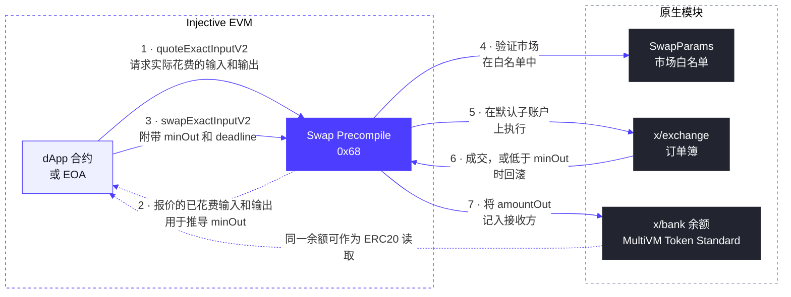

<a id="swap-precompile" />

Injective 的 Swap Precompile 在 `0x0000000000000000000000000000000000000068` 处向 EVM 应用开放原生现货交易所。使用它可以读取订单簿报价、设置最低输出和截止时间，并在一次调用中执行兑换。

<Note>
V1 exact-input 方法和 `quoteExactOutputV1` 从 v1.20.4 起可用。V2 方法、exact-output 执行以及 EVM 原生 MTS 代币解析将在 v1.21 中发布，包括测试网 v1.21.0-beta。
</Note>

<a id="create-the-project" />

## 演练 {#walkthrough}

按照 [swap precompile 演示](https://github.com/InjectiveLabs/inj-examples/blob/main/examples/swap-precompile/README.md)操作，可以检查测试网白名单、对两种兑换类型进行报价和模拟、提交交易，或在全新的本地链上运行完整流程。

## 工作原理 {#how-it-works}

1. 选择网络和受支持的现货市场。
2. 解析输入代币，并以其原生整数单位表示数量。
3. 读取报价，然后推导出最低输出和截止时间。
4. 从有资金的调用方模拟兑换，提交交易，并等待成功的回执。



报价读取当前订单簿，不会改变状态。执行时会在调用方的默认子账户上下一个原子现货市价单，并将输出记入接收方。如果最低输出或截止时间检查失败，兑换的状态变更会回滚。交易 gas 仍可能被收取。

对于 exact input，`amountIn` 是输入预算。流动性不足或数量 tick 可能导致其中一部分未被花费。剩余部分保留在调用方账户中，`minOut` 设定成交的最低输出。对于 exact output，执行必须在 `maxAmountIn` 范围内交付至少 `amountOut`，否则回滚。数量 tick 可能导致实际交付的输出略多。

在报价和执行之间，订单可能会发生变化。报价使用未打折的 taker 费率，而执行时会应用调用方的费用折扣，并跳过已暂停或已冻结的 maker。请使用新的报价来设置你的限制条件。执行时会强制检查 exact input 的 `minOut` 或 exact output 的 `maxAmountIn`，以及你设置的任何截止时间。

## Swap Precompile 接口 {#swap-precompile-interface}

```solidity
interface ISwapModule {
    /// Quote the input consumed and output received for an input budget.
    function quoteExactInputV2(
        address tokenIn,
        string calldata marketId,
        uint256 amountIn
    ) external view returns (uint256 amountInSpent, uint256 amountOut);

    /// Execute within minOut and deadline; return spent input and output.
    function swapExactInputV2(
        address tokenIn,
        string calldata marketId,
        uint256 amountIn,
        uint256 minOut,
        address recipient,
        uint256 deadline
    ) external returns (uint256 amountInSpent, uint256 amountOut);

    /// Legacy exact-input quote; returns only output.
    function quoteExactInputV1(
        address tokenIn,
        string calldata marketId,
        uint256 amountIn
    ) external view returns (uint256 amountOut);

    /// Legacy exact-input swap; returns only output.
    function swapExactInputV1(
        address tokenIn,
        string calldata marketId,
        uint256 amountIn,
        uint256 minOut,
        address recipient,
        uint256 deadline
    ) external returns (uint256 amountOut);

    /// Quote the input required to receive the target output.
    function quoteExactOutputV1(
        address tokenOut,
        string calldata marketId,
        uint256 amountOut
    ) external view returns (uint256 amountIn);

    /// Receive at least amountOut while spending at most maxAmountIn.
    function swapExactOutputV1(
        address tokenOut,
        string calldata marketId,
        uint256 amountOut,
        uint256 maxAmountIn,
        address recipient,
        uint256 deadline
    ) external returns (uint256 amountInSpent, uint256 amountOutDelivered);
}
```

- `marketId` 是以 `0x` 为前缀的 32 字节现货市场 ID，以 ABI `string` 类型传入。
- `tokenIn` 为 exact input 选择输入方向。`tokenOut` 为 exact output 选择要接收的资产。原生 INJ 使用零地址。其他代币通过[已注册的 ERC20 代币对](/cn/developers-evm/erc20-module)或 v1.21 上的 EVM 原生 MTS `erc20:` denom 解析。
- 数量使用代币的最小单位。例如，10 USDC 为 `10000000`。`minOut` 使用输出代币单位，`maxAmountIn` 使用输入代币单位。
- 当 `recipient` 设置为零地址时，默认为调用方。precompile 会花费直接调用方的 bank 余额，包括由合约调用时。调用时交易 value 必须为零。无需 ERC20 授权。
- `deadline` 是以秒为单位的 Unix 时间戳。设为零可禁用时间检查。

V1 和 V2 后缀指的是 precompile 的 ABI 版本。exchange 模块的 protobuf 类型版本独立管理。

将已结算的兑换与 precompile 返回的数量进行核对时，请允许存在一个最小代币单位的差异。小数部分会累积在调用方的默认子账户中，并可能影响整单位何时转入或转出 bank 余额。

## 市场白名单 {#market-allowlist}

可兑换的市场由 `SwapParams` 管理，它是 exchange 模块参数中的一个启用标志加一个市场白名单。在不在白名单中的市场上调用 precompile 会回滚，并返回：

```text
market <id> is not allowlisted for swaps: invalid swap route
```

### 查看当前白名单 {#checking-the-current-allowlist}

选择你的网络，查询 exchange 模块的 v2 swap 参数。

<Tabs>
<Tab title="测试网">

```bash
curl -fsS https://testnet.sentry.lcd.injective.network/injective/exchange/v2/exchangeParams \
  | jq '.params.swap_params'
```

</Tab>
<Tab title="主网">

```bash
curl -fsS https://sentry.lcd.injective.network/injective/exchange/v2/exchangeParams \
  | jq '.params.swap_params'
```

</Tab>
</Tabs>

使用 `jq '.params.exchange_admins'` 列出所选网络上的 exchange 管理员。

### 申请添加市场 {#requesting-a-market}

如果你正在基于 swap precompile 进行构建并需要将某个市场加入白名单，请在 [Injective Discord](https://discord.gg/injective) 的 `#developers` 频道中提供现货市场 ID，或联系你的 Injective 合作伙伴。活跃现货市场的市场 ID 可在 `/injective/exchange/v2/spot/markets?status=Active` 中查询。

### 更新白名单（exchange 管理员） {#updating-the-allowlist-exchange-admins}

`MsgUpdateSwapParams` 可由治理权限账户或 `exchange_admins` 参数中的任何地址调用。由管理员发送时，它会立即生效，无需治理投票。

该消息会**完全替换** swap 参数组。请始终包含所有应保留在白名单中的市场，并保持 `enabled: true`，因为遗漏现有市场会将其移除，而遗漏该标志会暂停所有兑换。

```json
{
  "body": {
    "messages": [
      {
        "@type": "/injective.exchange.v2.MsgUpdateSwapParams",
        "sender": "<admin inj1... address>",
        "swap_params": {
          "enabled": true,
          "allowed_markets": ["0x<existing market id>", "0x<new market id>"]
        }
      }
    ]
  },
  "auth_info": {
    "fee": {
      "amount": [{ "denom": "inj", "amount": "200000000000000" }],
      "gas_limit": "400000"
    }
  }
}
```

使用管理员密钥通过 `injectived tx sign` 和 `injectived tx broadcast` 对交易文档进行签名和广播。
