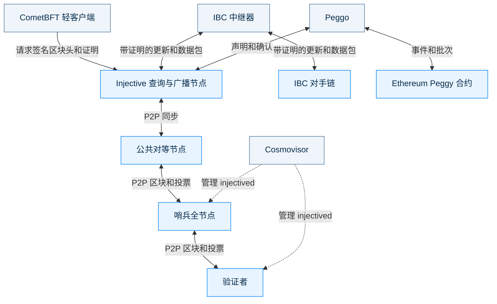
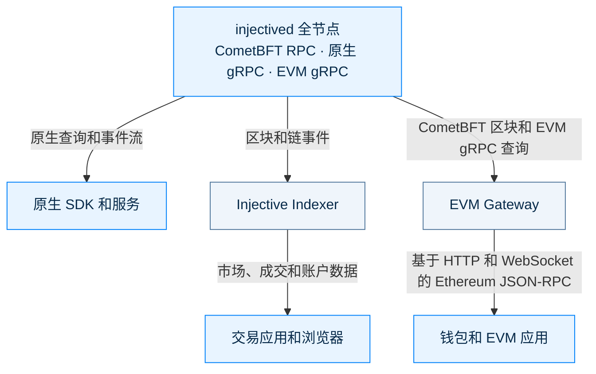

Injective 节点运行 `injectived`，即 Injective Core 可执行文件。作为节点守护进程，它运行 Injective 的原生执行模块和 EVM，并使用 CometBFT 进行对等网络通信和共识。同一可执行文件还提供用于查询链状态和提交交易的命令行工具。节点二进制文件请参阅[安装主网版本](/cn/infra/run-node#install-the-mainnet-release)。

验证者是通过绑定原生 INJ 并对区块进行提议和投票来帮助保障 Injective 安全的节点。其投票权反映其绑定的质押量，包括委托给它们的 INJ。当代表超过三分之二投票权的验证者对某个区块进行 precommit 后，CometBFT 就会提交该区块。这使得已提交的区块在正常网络条件下具有亚秒级最终性。哨兵节点为验证者承载对等流量，中继器提交跨链消息，API 服务提供链数据访问。

## 共识与中继路径 {#consensus-and-relay-paths}

下图展示了一个位于哨兵对等节点之后的验证者。运营者可以使用单独的全节点处理公共查询和交易提交。

### 验证者、哨兵节点和轻客户端 {#validators-sentries-and-light-clients}

- **验证者**是已绑定质押的共识参与者。它们运行 `injectived`、验证区块，并使用验证者密钥对提案和投票进行签名。请参阅[验证者设置](/cn/infra/validator-mainnet)。
- **哨兵节点**是与验证者及更广泛网络建立对等连接的全节点，使验证者可以将其对等地址和 RPC 保持私密。它们验证区块并中继对等流量。全节点可以剪枝历史状态，同时仍能验证新区块。归档节点会保留历史状态，用于查询和回填。请参阅[运行主网节点](/cn/infra/run-node)、[硬件要求](/cn/infra/hardware)和[归档设置](/cn/infra/archival-setup)。
- **CometBFT 轻客户端**从可信起点验证签名的区块头，并使用已验证的区块头检查应用状态证明。它们可以查询全节点，而无需执行每笔交易或存储完整的链状态。IBC 通过其 `07-tendermint` 轻客户端使用这种验证。对手链使用该客户端验证 Injective 区块头，并检查数据包和确认的证明。请参阅 [CometBFT](https://github.com/cometbft/cometbft) 和 [IBC Go](https://github.com/cosmos/ibc-go)。
- **Cosmovisor** 是一个可选的进程管理器，会自动轮询 `$DAEMON_HOME/data/upgrade-info.json` 以获取升级信号。在预定高度，`injectived` 会将升级计划写入该文件。如果启用了 `DAEMON_RESTART_AFTER_UPGRADE`（默认启用），Cosmovisor 随后会切换到准备好的二进制文件并重启节点。请参阅 [Cosmovisor 设置](/cn/infra/cosmovisor)和 [Cosmovisor v1.5.0](https://github.com/cosmos/cosmos-sdk/tree/tools/cosmovisor/v1.5.0/tools/cosmovisor)。

### IBC 中继器和 Peggo {#ibc-relayers-and-peggo}

- **IBC 中继器**监视两条链、支付 gas，并提交客户端更新、数据包证明、确认和超时。每条接收链都使用其链上的对手链 IBC 轻客户端来验证这些证明。请参阅 [Hermes](https://github.com/informalsystems/hermes)、[IBC Go](https://github.com/cosmos/ibc-go) 和 [IBC precompile 参考](/developers-evm/ibc-precompile)。
- **Peggo** 是 Injective 与 Ethereum 之间 Peggy 跨链桥的独立 orchestrator。它观察 Ethereum 跨链桥事件，向 Injective 提交声明和确认，并将验证者集更新和提款批次中继到 Ethereum 合约。请参阅 [Peggo 设置](/cn/infra/validator-mainnet/peggo)、[Peggy 模块](/developers-native/injective/peggy)和 [Peggo 版本](https://github.com/InjectiveFoundation/injective-core/releases)。

## 应用如何读取链 {#how-applications-read-the-chain}

使用原生查询端点获取当前链状态，使用 indexer 获取已索引的市场和交易历史，使用 EVM Gateway 获取 Ethereum JSON-RPC。每个服务都可以使用各自的上游全节点。

- **内置 EVM gRPC** 是 `injectived` 中的 `injective.evm.v1.Query` 服务。它为 gRPC 客户端（包括 EVM Gateway）提供 EVM 状态查询以及 `EthCall` 和 `EstimateGas` 等模拟方法。请参阅 [EVM 查询定义](https://github.com/InjectiveLabs/injective-proto/blob/master/all_protos/injective/evm/v1/query.proto)。
- **EVM Gateway** 独立于 `injectived` 运行。它读取 CometBFT 区块数据并使用原生 gRPC 查询，构建 EVM 区块、交易、回执和日志的本地索引，并提供 Ethereum JSON-RPC 服务。请参阅 [EVM Gateway 说明](/cn/developers-evm/evm-gateway)和 [Gateway 源码](https://github.com/InjectiveLabs/evm-gateway)。
- **Injective Indexer** 将链事件处理为可查询的市场、订单、成交和账户活动记录。请参阅[查询 Indexer](/cn/developers-native/query-indexer)、[Indexer API 架构](/cn/developers/concepts/indexer-api)以及需要仓库访问权限的 [Indexer 仓库](https://github.com/InjectiveLabs/injective-indexer)。

<Warning>
Injective Core 可选的内置 Ethereum JSON-RPC 服务器仅用于本地开发和测试。生产环境推荐使用 [EVM Gateway](/cn/developers-evm/evm-gateway) 作为 Ethereum JSON-RPC 服务器。
</Warning>

有关服务地址，请参阅[主网公共端点](/cn/infra/public-endpoints)和[测试网公共端点](/cn/testnet/public-endpoints)。
