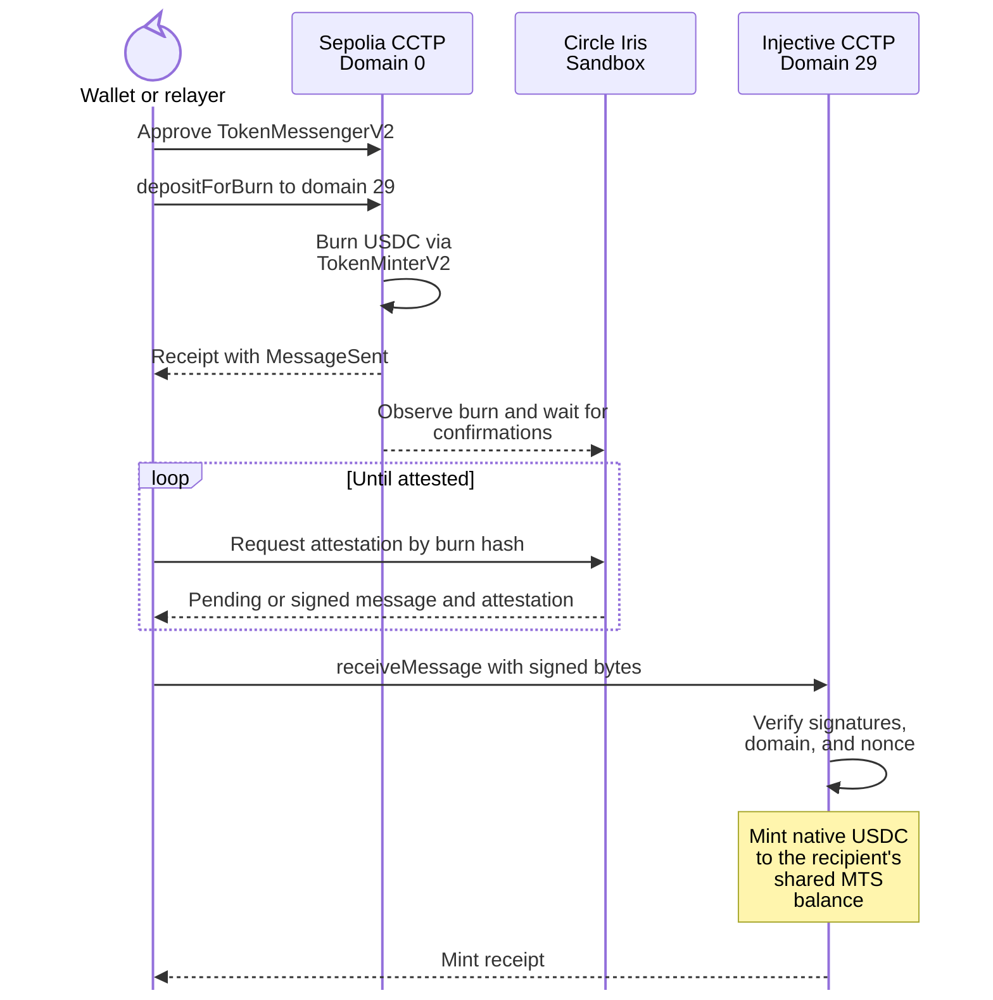

<Card title="Run the USDC CCTP demo" icon="flask-vial" href="https://github.com/InjectiveLabs/inj-examples/blob/main/examples/usdc/README.md" arrow="true">
  Follow the walkthrough to transfer testnet USDC between Ethereum Sepolia and Injective Testnet in either direction.
</Card>

Circle's Cross-Chain Transfer Protocol (CCTP) moves native USDC between supported chains. It burns USDC on the source network and mints native USDC on the destination network. The recipient receives the burned amount minus any CCTP fee charged at mint.

On Injective, the CCTP contracts run on the EVM. Circle USDC implements the [MultiVM Token Standard](/developers-evm/multivm-token-standard), so an account credited on Injective has one USDC balance shared by its EVM and native interfaces. An IBC voucher or another token that uses the symbol USDC has its own token identity. Use the Circle deployment for the network. [USDC contracts and FAQ](/developers-defi/usdc-stablecoin).

## Architecture

| Component | Responsibility |
| --- | --- |
| `TokenMessengerV2` | Accepts the burn request on the source chain. On the destination, receives the authenticated message and passes the mint to `TokenMinterV2`. |
| `TokenMinterV2` | Burns the local USDC on the source and resolves the source token to the corresponding local USDC on the destination. |
| `MessageTransmitterV2` | Emits `MessageSent` on the source. On the destination, verifies the signed message, checks the destination and nonce, and dispatches the message. |
| Circle Iris | Observes the source transaction and returns the CCTP message and attestation when the required confirmation level is reached. |
| Destination submitter | Calls `receiveMessage` and pays destination gas. This can be the sender, the recipient, or a relayer permitted by the message. |

CCTP uses **domain IDs** for routing. Use EVM chain IDs to select wallet networks and RPC endpoints. Keep contract addresses and the Iris environment aligned with the chain pair. [Circle contract addresses](https://developers.circle.com/cctp/references/contract-addresses).

| Network | EVM chain ID | CCTP domain ID |
| --- | --- | --- |
| Injective Mainnet | `1776` | `29` |
| Injective Testnet | `1439` | `29` |
| Ethereum Mainnet | `1` | `0` |
| Ethereum Sepolia | `11155111` | `0` |

## Transfer lifecycle

This sequence shows Sepolia as the source and Injective Testnet as the destination. The reverse direction uses the same steps with the source and destination domains exchanged.

<Steps>
  <Step title="Approve and burn USDC">

The sender gives the source `TokenMessengerV2` an ERC-20 allowance for the amount it will burn. The sender then calls `depositForBurn` with the source token address and amount, the destination domain, and the destination recipient. USDC uses six decimals, so 1 USDC is `1000000` base units.

Encode an EVM recipient as a left padded `bytes32` value. The recipient sets who gets the minted USDC. The separate `destinationCaller` field controls who can submit the mint transaction. Pass zero bytes to allow any submitter.

The call also sets `maxFee` in USDC base units and requests a confirmation level through `minFinalityThreshold`. A successful source receipt and `MessageSent` log establish that the burn happened and give the integrator a transaction hash to track. [Circle EVM contract interfaces](https://developers.circle.com/cctp/references/contract-interfaces).

  </Step>
  <Step title="Fetch the Circle attestation">

Request the attestation from **Circle Iris**, Circle's hosted CCTP attestation API. For this Testnet transfer, use the Circle sandbox. A burn on Sepolia uses the URL `https://iris-api-sandbox.circle.com/v2/messages/0?transactionHash={burnTxHash}`. Replace `{burnTxHash}` with the hash from the source transaction receipt.

The domain in the URL identifies where the burn occurred. Use `0` for Sepolia and `29` when burning on Injective Testnet. For Mainnet transfers, use `https://iris-api.circle.com` with the same `/v2/messages/{sourceDomain}` path and transaction hash parameter.

Circle signs the message once it meets the confirmation requirement. While Iris indexes the burn or waits for confirmations, keep tracking the same hash. Once it reports `complete`, retain both the `message` and `attestation` bytes. An application that supports batching should track each message returned for a transaction separately.

  </Step>
  <Step title="Submit the message and mint on the destination">

Pass the original message and attestation to the destination `MessageTransmitterV2.receiveMessage`. The transmitter verifies the attester signatures, checks the destination domain and any caller restriction, and rejects replay of a used nonce. It passes the authenticated message to the destination `TokenMessengerV2`, which mints through `TokenMinterV2`.

Confirm a successful destination receipt and verify the recipient's USDC balance. If a fee was executed, the recipient receives the burn amount minus that fee. The account submitting the call pays gas in the destination native currency, such as INJ on Injective. The mint recipient comes from the signed message.

  </Step>
</Steps>

## Finality and fees

| Mode | Request | Effect |
| --- | --- | --- |
| Standard Transfer | `minFinalityThreshold = 2000` | Circle waits for finality on the source chain. Use Standard when burning on Injective. |
| Fast Transfer | `minFinalityThreshold = 1000` | On supported source chains, Circle can attest sooner within its Fast Transfer allowance. Use the current route fee to set `maxFee`. |

Injective reaches finality quickly and uses Standard Transfer as a source. A Standard burn on Sepolia can take several minutes longer to attest. Actual wait time includes Iris processing and the app's polling interval. [Circle finality and confirmation times](https://developers.circle.com/cctp/concepts/finality-and-block-confirmations).

The fee cap authorizes a maximum. Check the current route fee using `GET /v2/burn/USDC/fees/{sourceDomain}/{destinationDomain}`, convert the quoted basis points to USDC base units, and account for any onchain minimum. Circle can fall back to Standard when a Fast Transfer is ineligible. Treat the attested fee as the amount deducted at mint. Chain gas is separate. [Circle fee rules](https://developers.circle.com/cctp/concepts/fees).

## Track and recover transfers

<AccordionGroup>
  <Accordion title="The burn succeeded and the attestation is pending">

Check the Iris environment, source domain, and transaction hash. Check the burn receipt for `MessageSent`. An Iris delay reason can explain a longer wait, such as Fast Transfer falling back to Standard. Continue checking the existing burn hash.

  </Accordion>
  <Accordion title="The attestation is ready and minting failed">

Check the destination chain, transmitter, and submitter gas balance. If the nonce was already used, find the successful mint and verify the recipient balance. If Circle reports an expired Fast Transfer message, follow its reattestation flow to recover the existing transfer. [Circle CCTP troubleshooting](https://developers.circle.com/cctp).

  </Accordion>
</AccordionGroup>
