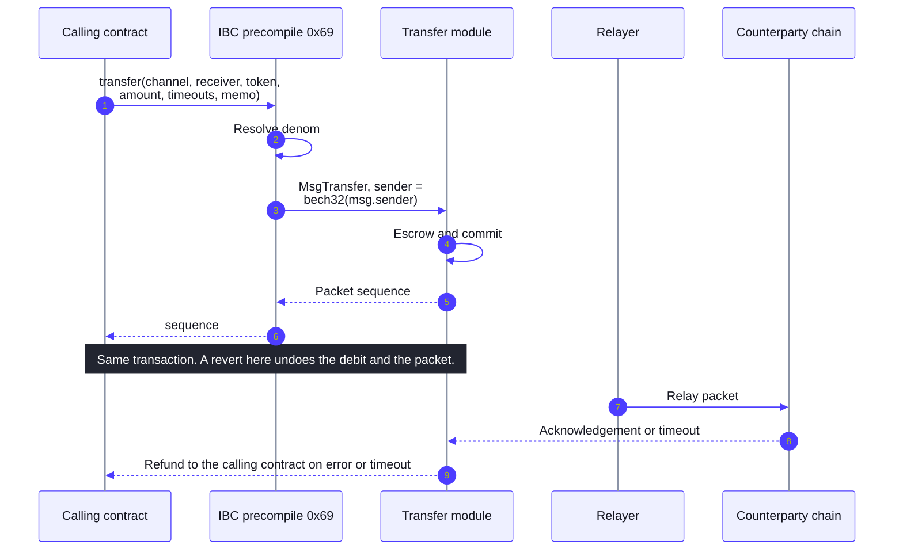
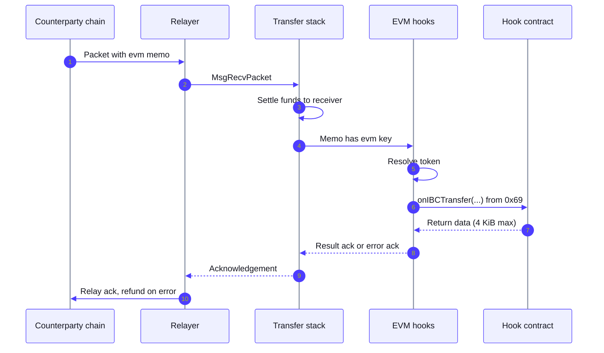

# IBC Precompile

<Warning>
**Rollout status (November 2026).** The IBC precompile and the inbound EVM hooks ship in `v1.21.0`. Testnet (`injective-888`) upgrades on 5 November 2026 with `v1.21.0-beta`. The mainnet upgrade is targeted for 17 November 2026 and is subject to governance. Until the mainnet upgrade completes, calls to `0x69` on mainnet revert.
</Warning>

The IBC precompile is a system smart contract at the fixed address `0x0000000000000000000000000000000000000069`.

It allows EVM callers on Injective to initiate ICS20 token transfers, and inbound ICS20 transfers with appropriate memo instructions to invoke an EVM receiver contract.

Both transfer directions on Injective move tokens according to the [MultiVM Token Standard](/developers-evm/multivm-token-standard). The token must already be registered as an MTS pair. The amount an EVM caller sends is debited from its own native bank balance, and the amount a hook contract receives is always read as view of the native bank balance. N

## Quick reference

| Item | Details |
|---|---|
| Precompile | `0x0000000000000000000000000000000000000069`, registered as `INJ_IBC` |
| Interface | `IIBCModule` in [`src/IBC.sol`](https://github.com/InjectiveLabs/solidity-contracts/blob/v1.21.0-rc.1/src/IBC.sol) |
| Method | `transfer(string,string,address,uint256,(uint64,uint64),uint64,string)` returns `uint64 sequence` |
| Port | `transfer`, fixed |
| Sender | The Injective bech32 address derived from `msg.sender`, the immediate caller |
| Funding | The caller's own bank balance. No approval, no `msg.value` |
| Tokens | `address(0)` for INJ, otherwise an ERC20 address with a MultiVM token pair or an implicit `erc20:` denom |
| Inbound hook | Memo `{"evm": {"contract", "payload", "gas_limit"}}` calls `onIBCTransfer(...)` from system address `0x69` |

## How an outbound transfer works



Steps 1 to 6 run inside the calling transaction. The precompile resolves the token to a bank denom, builds an ICS20 `MsgTransfer` with the caller as sender, and hands it to the transfer module, which escrows or burns the amount and commits the packet. The returned sequence identifies the packet. If the enclosing EVM execution reverts after the call, the debit, the packet commitment and the sequence update are all rolled back with it.

Steps 7 to 10 happen later, in other transactions. A relayer carries the packet, the counterparty acknowledges it or lets it time out, and the transfer module processes the result. A successful call to `transfer` means the packet was dispatched. It does not mean the receiver was credited. On an error acknowledgement or a timeout, the escrowed amount returns to the sender, which is the calling contract, not the account that called the contract.

## Interface

```solidity
interface IIBCModule {
    struct TimeoutHeight {
        uint64 revisionNumber;
        uint64 revisionHeight;
    }

    function transfer(
        string calldata sourceChannel,
        string calldata receiver,
        address token,
        uint256 amount,
        TimeoutHeight calldata timeoutHeight,
        uint64 timeoutTimestamp,
        string calldata memo
    ) external returns (uint64 sequence);
}
```

| Parameter | Meaning |
|---|---|
| `sourceChannel` | ICS20 channel on Injective, such as `channel-N`. The port is always `transfer`. |
| `receiver` | The address as the counterparty chain understands it. It is not restricted to an Injective or EVM format. Up to 2,048 bytes. |
| `token` | `address(0)` for INJ. Otherwise the ERC20 address of a token with a MultiVM token pair, or an EVM native token whose  `erc20:0x...` denom has supply or metadata. |
| `amount` | Smallest denomination of the token. Must be positive. `2^256 - 1` is rejected because ibc-go treats it as "the whole balance". |
| `timeoutHeight` | Counterparty client height. `{0, 0}` disables the height timeout. |
| `timeoutTimestamp` | Absolute Unix time in nanoseconds. `0` disables the timestamp timeout. At least one timeout must be set, as required by the underlying IBC implementation. |
| `memo` | ICS20 memo, up to 32,768 bytes. A memo containing the `ibc_callback` key is rejected for EVM senders. |

The precompile declares no events. The transfer module emits the standard ICS20 events for the packet.

### Token resolution

| `token` | Resolves to |
|---|---|
| `address(0)` | `inj` |
| Address with a registered token pair (bank native denoms from TokenFactory, Peggy or IBC) | The pair's bank denom |
| Address of an EVM native MultiVM token whose `erc20:0x...` denom has supply or metadata | `erc20:0x...` |
| Anything else | Revert: `token 0x... is not registered as a bank token pair` |

Query token pairs through the ERC20 module:

```bash
curl -s https://sentry.lcd.injective.network/injective/erc20/v1beta1/token_pair_by_erc20_address/0xAddress | jq
```

### Who pays and who is refunded

The ICS20 sender is the bech32 form of `msg.sender`, the account or contract that calls `0x69` directly. The amount is debited from that account's bank balance synchronously. A user calling a router that calls the precompile does not become the sender. The router is the sender, the router's balance is debited, and any refund after a timeout or an error acknowledgement lands on the router. A contract that forwards transfers for users needs its own accounting for refunds and a way to sweep them.

No ERC20 `approve` is involved. Only the caller's own balance can be sent. The method is not payable and reverts with `the IBC precompile does not accept value transfers` if value is attached.

### Gas

The call charges an upfront floor of 200,000 gas plus a per byte cost on the calldata. Native work performed by the transfer module beyond that floor is charged to the EVM frame at a rate of 10 native gas units per EVM gas unit. If the native work exhausts the gas available to the frame, the call fails with an EVM out of gas error. This is deliberate: a Solidity caller cannot catch it with `try`/`catch` and continue as if the transfer had been attempted. The entire ABI encoded call is limited to 36 KiB, which accommodates the maximum memo and receiver sizes.

### Failure behavior

The call reverts, with no native or EVM state change, when the token cannot be resolved, the amount is zero or above the caller's spendable balance, the channel does not exist or is closed, the timeout configuration is rejected by IBC, the receiver or memo fail ICS20 validation, or escrow, burn or packet commitment fails. The revert reason carries the underlying message, prefixed with `invalid IBC transfer:` for validation failures and `IBC transfer failed:` for transfer module failures. Static calls revert with `the transfer method is not readonly`.

## Calling the precompile from Solidity

```solidity
import {IIBCModule} from "injective-solidity-contracts/src/IBC.sol";

contract IBCForwarder {
    IIBCModule constant IBC = IIBCModule(0x0000000000000000000000000000000000000069);

    function forward(
        string calldata channel,
        string calldata receiver,
        address token,
        uint256 amount,
        string calldata memo
    ) external returns (uint64) {
        IIBCModule.TimeoutHeight memory noHeight = IIBCModule.TimeoutHeight(0, 0);
        uint64 timeoutNs = uint64(block.timestamp + 10 minutes) * 1e9;
        return IBC.transfer(channel, receiver, token, amount, noHeight, timeoutNs, memo);
    }
}
```

The contract holds the tokens it forwards. `block.timestamp` is in seconds and the timeout field is in nanoseconds, so the multiplication by `1e9` is required. Refunds for timed out or rejected packets return to this contract's balance, so a production version needs a sweep function and a record of which transfers are still in flight.

Live channel identifiers are not listed here because they change. Query them:

```bash
curl -s https://sentry.lcd.injective.network/ibc/core/channel/v1/channels | jq '.channels[] | {channel_id, state, counterparty}'
```

## Inbound EVM hooks

An ICS20 packet arriving on Injective can call a contract after the transfer settles. The sending side puts an `evm` object in the packet memo:

```json
{
  "evm": {
    "contract": "0xYourContractAddress",
    "payload": "0x0102",
    "gas_limit": 500000
  }
}
```

| Field | Meaning |
|---|---|
| `contract` | EVM address of the hook contract. It must have code. |
| `payload` | Hex encoded bytes passed to the contract unchanged. |
| `gas_limit` | EVM gas for the hook call. Must be above zero and at or below the hook gas cap. |



Funds settle to the ICS20 receiver first, through the normal transfer path. Only then does the hooks middleware read the memo and call the contract. A hook that reverts, a target address without code, return data above 4,096 bytes, or a `gas_limit` above the cap each produce an error acknowledgement. The counterparty processes that acknowledgement and refunds the original sender there. A relayer that supplies too little gas for the hook causes the relay transaction itself to fail, which is retryable and does not produce an acknowledgement.

The success acknowledgement is a JSON object with two fields: `contract_result`, the hook's return data, and `ibc_ack`, the underlying ICS20 acknowledgement.

### Hook contract requirements

```solidity
contract IBCReceiver {
    address public constant IBC_SYSTEM_ADDRESS = 0x0000000000000000000000000000000000000069;

    event Received(string destChannelId, string packetSender, address token, uint256 amount, address receiver, bytes payload);

    function onIBCTransfer(
        string calldata destChannelId,
        string calldata packetSender,
        address token,
        uint256 amount,
        address receiver,
        bytes calldata payload
    ) external returns (bytes memory) {
        require(msg.sender == IBC_SYSTEM_ADDRESS, "unauthorized ibc caller");
        emit Received(destChannelId, packetSender, token, amount, receiver, payload);
        return abi.encode(true);
    }
}
```

| Parameter | Meaning |
|---|---|
| `destChannelId` | The Injective side channel the packet arrived on. |
| `packetSender` | The sender string from the packet, as the counterparty wrote it. It is raw packet data and is not authenticated by Injective. A contract must not treat it as a verified identity. |
| `token` | `address(0)` for INJ, otherwise the ERC20 address resolved from the received denom. |
| `amount` | Amount in the token's smallest denomination, already credited to `receiver`. |
| `receiver` | The EVM form of the ICS20 receiver address. The funds are on this account when the hook runs. |
| `payload` | The bytes from the memo. |

The call always comes from `0x0000000000000000000000000000000000000069`, with a zero gas price. The `require` on `msg.sender` is what prevents any other account from invoking the hook with forged parameters. Without it, anyone can call `onIBCTransfer` directly.

The hook contract does not receive the funds unless `receiver` is the contract itself. The ICS20 receiver is set by the sender on the counterparty chain, so a flow that wants the contract to hold the funds sets the receiver to the contract's Injective address and names the same contract in the memo.

### Token resolution for inbound packets

| Received denom | `token` passed to the hook |
|---|---|
| `inj` | `address(0)`. The receiver holds it as native EVM balance. |
| Bank native denom with a token pair (Peggy, IBC, TokenFactory) | The pair's ERC20 address |
| `erc20:0x...` denom of an EVM native MultiVM token with supply or metadata | That address |
| Denom without a pair | Error acknowledgement: `no MTS token pair exists for denom ...`, sender refunded |

An IBC denom arriving on Injective for the first time has no token pair. Pair creation for IBC denoms is permissionless under the MultiVM Token Standard, and the pair must exist before a hook can deliver that token. See [MultiVM Token Standard](/developers-evm/multivm-token-standard).

### Hook gas cap

The cap is the smaller of the txfees `MaxGasWantedPerTx` parameter and the block gas limit, minus a 5,000,000 gas reserve for the rest of the relay transaction. On mainnet this works out to 70,000,000. A `gas_limit` above the cap is rejected before any execution with `IBC hook gas limit N exceeds the cap of M`, as an error acknowledgement.

## Observing hook calls through the EVM gateway

The chain emits `injective.evm.v1.EventIBCHookCall` for every attempted hook call, with the destination port and channel, packet sequence, contract, ABI encoded input, success flag and return data. The [EVM gateway](/developers-evm/evm-gateway) virtualizes this event into a synthetic transaction, receipt and logs, so `eth_getTransactionReceipt` and `eth_getLogs` show hook executions alongside ordinary EVM transactions. The receipt carries the contract's own logs followed by one summary log emitted from the reserved pseudo address `0x0000000000000000000000000000000000000800` with the topic `IBCHookCall(string,string,uint64,address,bool,bytes,string,uint256)`. The pseudo address differs from the hook caller `0x69` so that summary logs are distinguishable from logs emitted by contracts.

<Note>
Gateway support for hook events requires a gateway release that includes this virtualization. Check the gateway version your RPC provider runs before relying on synthetic receipts. Native queries through the LCD remain available regardless: packet commitments at `/ibc/core/channel/v1/channels/{channel}/ports/transfer/packet_commitments` and acknowledgements at `/ibc/core/channel/v1/channels/{channel}/ports/transfer/packet_acks/{sequence}`.
</Note>

## Calling from the command line

Precompiles exist only on real Injective nodes. Foundry's local simulation has no `0x69`, so `forge script` and `forge test` revert with `call to non-contract address` on any path that touches it. Use `cast` against a live RPC, or the [local development setup in inj-examples](https://github.com/InjectiveLabs/inj-examples/tree/main/examples/precompiles/local-dev), or the patched [Injective Foundry](https://github.com/InjectiveLabs/foundry/releases) build.

```bash
cast send 0x0000000000000000000000000000000000000069 \
  "transfer(string,string,address,uint256,(uint64,uint64),uint64,string)" \
  "channel-N" "<RECEIVER>" 0x0000000000000000000000000000000000000000 1000000000000000000 \
  "(0,0)" <TIMEOUT_NS> "" \
  --private-key $PK --rpc-url https://k8s.testnet.json-rpc.injective.network --gas-limit 600000
```

This sends 1 INJ. `<TIMEOUT_NS>` is an absolute Unix time in nanoseconds, for example `$(( $(date +%s) + 600 ))000000000` for ten minutes from now.

## Known limitations

- A returned sequence means the packet was dispatched. Delivery and the acknowledgement are asynchronous.
- Refunds after a timeout or error acknowledgement land on the calling contract, not on the account that called the contract.
- The precompile emits no EVM events. Observe the transfer through the ICS20 events and the packet sequence.
- EVM contracts receive no callback for acknowledgements or timeouts of their outbound transfers. The `ibc_callback` memo path is for Wasm senders only and is rejected here.
- The hook delivers tokens only when the received denom resolves to an EVM address. Unpaired denoms produce an error acknowledgement and a refund.
- `packetSender` is unauthenticated packet data.
- Synthetic receipts and logs for hook calls depend on the gateway version your RPC provider runs.
- The method is not available in Foundry's simulated EVM.

## Start building

The interface and the documentation that accompanies it live in the [solidity-contracts](https://github.com/InjectiveLabs/solidity-contracts) repository (`src/IBC.sol`, `docs/ibc_precompile.md`). The address table for every precompile is on the [Precompiles](/developers-evm/precompiles) page. For channel enablement and integration support, ask in the `#developers` channel of the [Injective Discord](https://discord.gg/injective) or contact your Injective partner contact.
