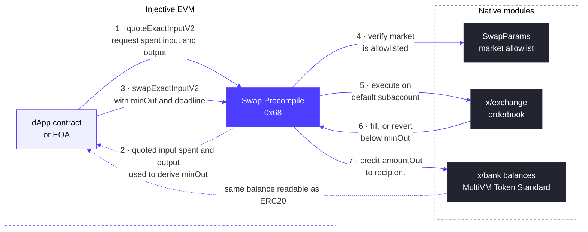

Injective’s Swap Precompile exposes the native spot exchange to EVM applications at `0x0000000000000000000000000000000000000068`. Use it to read an order-book quote, set a minimum output and deadline, and execute a swap in one call.

This page covers the interface, market allowlist, token units, and a complete TypeScript integration with viem. INJ and Circle USDC on testnet serve as the worked example; the same workflow applies to other active, allowlisted markets with supported token directions.

<Info>
  The TypeScript walkthrough uses the V2 exact-input API on testnet. Check the
  deployed API, supported direction, market allowlist, and available liquidity
  on your target network before submitting a transaction.
</Info>

## How it works

1. Select a network and a supported spot market.
2. Resolve the input token and express the amount in its native integer units.
3. Read a quote, then derive a minimum output and a deadline.
4. Simulate the swap from the funded caller, submit it, and wait for a successful receipt.



Quotes read the current order book without changing state. Execution places an atomic spot market order on the caller’s default subaccount and credits the output to the recipient. If the minimum output or deadline check fails, the swap’s state changes revert; transaction gas can still be charged.

The V2 methods return both `amountInSpent` and `amountOut`. `amountIn` is an input budget: thin liquidity or quantity ticks can leave part of it unspent. The swap creates no resting order for that remainder. `minOut` protects the absolute output of the fill; it does not require the whole input budget to be consumed. Show the estimated spent amount alongside the expected output.

Quotes can change before execution as orders and account-specific fees change. The execution-time minimum output and deadline are the binding constraints.

## Swap Precompile Interface

Use V2 exact-input methods when your application needs to report actual input consumption. The interface also exposes V1 exact-input and exact-output methods; check support on the deployed node.

```solidity
interface ISwapModule {
    /// Quote the input consumed and output received for an input budget.
    function quoteExactInputV2(
        address tokenIn,
        string calldata marketId,
        uint256 amountIn
    ) external view returns (uint256 amountInSpent, uint256 amountOut);

    /// Execute within minOut and deadline; return spent input and output.
    function swapExactInputV2(
        address tokenIn,
        string calldata marketId,
        uint256 amountIn,
        uint256 minOut,
        address recipient,
        uint256 deadline
    ) external returns (uint256 amountInSpent, uint256 amountOut);

    /// Legacy exact-input quote; returns only output.
    function quoteExactInputV1(
        address tokenIn,
        string calldata marketId,
        uint256 amountIn
    ) external view returns (uint256 amountOut);

    /// Legacy exact-input swap; returns only output.
    function swapExactInputV1(
        address tokenIn,
        string calldata marketId,
        uint256 amountIn,
        uint256 minOut,
        address recipient,
        uint256 deadline
    ) external returns (uint256 amountOut);

    /// Quote the input required to receive the target output.
    function quoteExactOutputV1(
        address tokenOut,
        string calldata marketId,
        uint256 amountOut
    ) external view returns (uint256 amountIn);

    /// Receive at least amountOut while spending at most maxAmountIn.
    function swapExactOutputV1(
        address tokenOut,
        string calldata marketId,
        uint256 amountOut,
        uint256 maxAmountIn,
        address recipient,
        uint256 deadline
    ) external returns (uint256 amountInSpent, uint256 amountOutDelivered);
}
```

Parameter notes:

- `marketId` is an ABI `string`, even though it contains a `0x`-prefixed 32-byte hash. It selects the order book.
- `tokenIn` determines the input side: the market’s base asset sells base for quote, and its quote asset buys base. Native INJ uses the zero address; other supported assets use their ERC20 address.
- `tokenOut` selects the asset to receive for exact-output methods.
- Amounts use each token’s native integer units. For example, `parseUnits('10', 6)` represents 10 USDC and `parseUnits('0.1', 18)` represents 0.1 INJ. Use decimal strings and bigint throughout.
- `minOut` is the minimum acceptable output in output-token units; `maxAmountIn` caps input in input-token units.
- `recipient` receives the output. For a direct EOA call, the precompile debits the caller’s existing bank/MTS balance; no ERC20 allowance to the precompile is needed.
- `deadline` is a Unix timestamp in seconds. Omit transaction `value`, including when selling INJ: a nonzero value reverts.

V1 exact-input methods return only output. V2 exposes spent input as well and is the focus of this guide. `quoteExactOutputV1` and `swapExactOutputV1` take the output token: they can express a target such as receiving at least a chosen INJ amount for a capped USDC input. Tick rounding can deliver slightly more than the target. Check support on the deployed node before adopting those methods.

The V1 and V2 suffixes on these ABI methods are API versions. They are separate from the exchange module’s legacy v1beta1 and current v2 protobuf types.

## Market allowlist

Swappable markets are governed by `SwapParams`, an enable flag plus a market allowlist inside the exchange module parameters. Calling the precompile on a market that is not allowlisted reverts with:

```text
market <id> is not allowlisted for swaps: invalid swap route
```

### Checking the current allowlist

The live allowlist is part of the exchange module's v2 parameters. Use the REST endpoint for your target network; the following command queries mainnet:

```bash
curl -s https://sentry.lcd.injective.network/injective/exchange/v2/exchangeParams \
  | jq '.params.swap_params'
```

For testnet, replace the host with `https://k8s.testnet.lcd.injective.network`. The same query's `.params.exchange_admins` field lists the addresses authorized to update it.

### Requesting a market

If you are building on the swap precompile and need a market allowlisted, reach out in the `#developers` channel of the [Injective Discord](https://discord.gg/injective) with the spot market id, or raise it with your Injective partner contact. Market ids for active spot markets are listed at `/injective/exchange/v2/spot/markets?status=Active`.

### Updating the allowlist (exchange admins)

`MsgUpdateSwapParams` is callable by the governance authority or any address in the `exchange_admins` parameter. It takes effect immediately, with no governance vote required when sent by an admin.

The message **fully replaces** the swap parameter group. Always include every market that should remain allowlisted and keep `enabled: true`, because omitting an existing market removes it and omitting the flag pauses all swaps.

```json
{
  "body": {
    "messages": [
      {
        "@type": "/injective.exchange.v2.MsgUpdateSwapParams",
        "sender": "<admin inj1... address>",
        "swap_params": {
          "enabled": true,
          "allowed_markets": ["0x<existing market id>", "0x<new market id>"]
        }
      }
    ]
  },
  "auth_info": {
    "fee": {
      "amount": [{ "denom": "inj", "amount": "200000000000000" }],
      "gas_limit": "400000"
    }
  }
}
```

Sign and broadcast the transaction document with `injectived tx sign` and `injectived tx broadcast` from the admin key.

## Quote and Swap Pattern

```solidity
(uint256 quotedSpent, uint256 quotedOut) = SWAP.quoteExactInputV2(
    tokenIn, marketId, amountIn
);
uint256 minOut = (quotedOut * (10_000 - slippageBps)) / 10_000;
(uint256 amountInSpent, uint256 amountOut) = SWAP.swapExactInputV2(
    tokenIn, marketId, amountIn, minOut, recipient, block.timestamp + 120
);
```

## TypeScript walkthrough

The following example quotes and simulates both directions of an INJ/USDC swap on testnet. It sends a transaction only when run with `--send`.

### Configure the worked example

| Setting         | Value                                                                |
| --------------- | -------------------------------------------------------------------- |
| EVM chain ID    | `1439`                                                               |
| Native chain ID | `injective-888`                                                      |
| EVM RPC         | `https://k8s.testnet.json-rpc.injective.network/`                    |
| Chain REST API  | `https://k8s.testnet.lcd.injective.network`                          |
| Swap precompile | `0x0000000000000000000000000000000000000068`                         |
| Spot market ID  | `0x0f6ee483a7f7f633fe6e3f03d34e01e129b5a5023eb7b0fe1e8a56e5ac8779a6` |
| Base asset      | Native INJ, 18 decimals                                              |
| Quote denom     | `erc20:0x0C382e685bbeeFE5d3d9C29e29E341fEE8E84C5d`                   |
| Quote decimals  | 6                                                                    |
| Quantity tick   | `0.0001` INJ                                                         |

The [EVM network reference](/developers-evm/network-information) supplies the RPC and chain IDs. Inspect the [market](https://k8s.testnet.lcd.injective.network/injective/exchange/v2/spot/markets/0x0f6ee483a7f7f633fe6e3f03d34e01e129b5a5023eb7b0fe1e8a56e5ac8779a6) and [swap parameters](https://k8s.testnet.lcd.injective.network/injective/exchange/v2/exchangeParams) for the current configuration.

[Circle’s deployment reference](https://developers.circle.com/stablecoins/usdc-contract-addresses) confirms the token address. The [asset page](https://testnet.injscan.com/asset/erc20:0x0C382e685bbeeFE5d3d9C29e29E341fEE8E84C5d/) identifies the matching bank denom.

### Understand the example call

The precompile converts an EVM call into an atomic spot market order in Injective’s exchange module. For the INJ/USDC worked example, the input token determines the direction:

| Action   | Input token               | Input amount         | Output      |
| -------- | ------------------------- | -------------------- | ----------- |
| Buy INJ  | Market USDC ERC20 address | USDC with 6 decimals | Native INJ  |
| Sell INJ | `zeroAddress`             | INJ with 18 decimals | Market USDC |

Circle USDC exposes the account’s bank balance through the MultiVM Token Standard. Its native bank denom is derived automatically as `erc20:<checksummed token address>`; no stored token-pair registration is required. Keep INJ in the account to pay transaction gas, including when buying INJ with USDC.

### Resolve the example token

For the worked example, the input token determines whether the call buys INJ with USDC or sells INJ for USDC. Token resolution must agree with the selected market’s base and quote denoms.

Query the denom resolution without listing all token pairs:

```bash
curl --get 'https://k8s.testnet.lcd.injective.network/injective/erc20/v1beta1/token_pair_by_erc20_address' \
  --data-urlencode 'erc20_address=0x0C382e685bbeeFE5d3d9C29e29E341fEE8E84C5d'
```

The response associates the ERC20 address with `erc20:0x0C382e685bbeeFE5d3d9C29e29E341fEE8E84C5d`. For EVM-native MTS tokens, this query can derive the relationship without a stored pair. Native TokenFactory denoms follow a different registration path; see the [ERC20 module reference](/developers-evm/erc20-module).

Fund a dedicated testnet EVM account with INJ from the [Injective faucet](https://testnet.faucet.injective.network/) and USDC from [Circle’s faucet](https://faucet.circle.com/). For buys, the book needs resting INJ sell orders; for sells, it needs resting buy orders funded with this USDC. A successful sell quote alone does not establish buy-side liquidity. Testnet order-book prices can be arbitrary; do not interpret the tutorial market as a reference for INJ’s real price.

### Create the project

Use Node.js 22 or later. Create a project directory and its source folder, then save the files below in it. A local `.env` must remain outside version control.

```bash
mkdir -p swap-precompile-guide/src
cd swap-precompile-guide
```

`package.json`:

```json
{
  "name": "injective-testnet-swap-guide",
  "version": "1.0.0",
  "private": true,
  "type": "module",
  "engines": {
    "node": ">=22"
  },
  "scripts": {
    "build": "tsc",
    "swap": "node --env-file-if-exists=.env dist/swap.js",
    "format": "prettier --write .",
    "format:check": "prettier --check ."
  },
  "dependencies": {
    "viem": "2.49.2"
  },
  "devDependencies": {
    "@types/node": "25.8.0",
    "typescript": "5.8.3",
    "prettier": "3.7.4"
  }
}
```

`tsconfig.json`:

```json
{
  "compilerOptions": {
    "target": "ES2022",
    "module": "NodeNext",
    "moduleResolution": "NodeNext",
    "strict": true,
    "outDir": "dist",
    "skipLibCheck": true
  },
  "include": ["src/**/*.ts"]
}
```

Save the formatter settings as `.prettierrc.js`:

```javascript
export default {
  endOfLine: 'auto',
  printWidth: 80,
  semi: false,
  singleQuote: true,
  trailingComma: 'none'
}
```

Save the exclusions as `.prettierignore`:

```text
node_modules/
dist/
verification-live.txt
```

Run `npm run format` to apply the project’s formatting, or `npm run format:check` to check it.

`.gitignore`:

```text
.env
node_modules/
dist/
```

`.env`:

```dotenv
RPC_URL=https://k8s.testnet.json-rpc.injective.network/
LCD_URL=https://k8s.testnet.lcd.injective.network
MARKET_ID=0x0f6ee483a7f7f633fe6e3f03d34e01e129b5a5023eb7b0fe1e8a56e5ac8779a6
SLIPPAGE_BPS=50
# Set only for --simulate or --send, using a dedicated testnet account.
# PRIVATE_KEY=0x...
```

Install and compile after adding the TypeScript files:

```bash
npm install
npm run build
```

### Define the network and ABI

Save as `src/config.ts`. The small ABI includes V1 for diagnostics and V2 for swaps that report actual input consumption.

```typescript
import { http, parseAbi, defineChain, createPublicClient } from 'viem'

export const RPC_URL =
  process.env.RPC_URL ?? 'https://k8s.testnet.json-rpc.injective.network/'
export const LCD_URL = (
  process.env.LCD_URL ?? 'https://k8s.testnet.lcd.injective.network'
).replace(/\/$/, '')
export const MARKET_ID =
  process.env.MARKET_ID ??
  '0x0f6ee483a7f7f633fe6e3f03d34e01e129b5a5023eb7b0fe1e8a56e5ac8779a6'
export const SWAP = '0x0000000000000000000000000000000000000068' as const
export const USDC_ADDRESS =
  '0x0C382e685bbeeFE5d3d9C29e29E341fEE8E84C5d' as const
export const USDC_DENOM = `erc20:${USDC_ADDRESS}`

export const chain = defineChain({
  id: 1439,
  name: 'Injective EVM Testnet',
  nativeCurrency: { name: 'Injective', symbol: 'INJ', decimals: 18 },
  rpcUrls: { default: { http: [RPC_URL] } },
  blockExplorers: {
    default: {
      name: 'Blockscout',
      url: 'https://testnet.blockscout.injective.network'
    }
  },
  testnet: true
})
export const client = createPublicClient({ chain, transport: http(RPC_URL) })
export const swapAbi = parseAbi([
  'function quoteExactInputV1(address tokenIn, string marketId, uint256 amountIn) view returns (uint256 amountOut)',
  'function quoteExactInputV2(address tokenIn, string marketId, uint256 amountIn) view returns (uint256 amountInSpent, uint256 amountOut)',
  'function swapExactInputV2(address tokenIn, string marketId, uint256 amountIn, uint256 minOut, address recipient, uint256 deadline) returns (uint256 amountInSpent, uint256 amountOut)'
])
export const tokenAbi = parseAbi([
  'function decimals() view returns (uint8)',
  'function balanceOf(address owner) view returns (uint256)'
])

export type Market = {
  ticker: string
  status: string
  market_id: string
  base_denom: string
  quote_denom: string
  min_notional: string
  base_decimals: number
  quote_decimals: number
  min_quantity_tick_size: string
}
export type SwapParams = { enabled: boolean; allowed_markets: string[] }
export type TokenPair = { bank_denom: string; erc20_address: string }

export async function lcd<T>(path: string): Promise<T> {
  const response = await fetch(`${LCD_URL}${path}`, {
    signal: AbortSignal.timeout(20_000)
  })
  if (!response.ok)
    throw new Error(`LCD ${response.status}: ${await response.text()}`)

  return (await response.json()) as T
}

export async function inspect() {
  if (!/^0x[0-9a-fA-F]{64}$/.test(MARKET_ID))
    throw new Error('MARKET_ID must be a 0x-prefixed 32-byte hash string')
  const [chainId, node, params, market, pair] = await Promise.all([
    client.getChainId(),
    lcd<{ default_node_info: { network: string } }>(
      '/cosmos/base/tendermint/v1beta1/node_info'
    ),
    lcd<{ params: { swap_params: SwapParams; exchange_admins: string[] } }>(
      '/injective/exchange/v2/exchangeParams'
    ),
    lcd<{ market: null | Market }>(
      `/injective/exchange/v2/spot/markets/${MARKET_ID}`
    ),
    lcd<{ token_pair: null | TokenPair }>(
      `/injective/erc20/v1beta1/token_pair_by_denom?bank_denom=${encodeURIComponent(USDC_DENOM)}`
    )
  ])
  if (chainId !== 1439 || node.default_node_info.network !== 'injective-888') {
    throw new Error(
      'RPC and LCD must both target Injective testnet (1439 / injective-888)'
    )
  }

  return {
    chainId,
    nativeChainId: node.default_node_info.network,
    swap_params: params.params.swap_params,
    exchange_admins: params.params.exchange_admins,
    market: market.market,
    tokenPair: pair.token_pair
  }
}
```

### Implement quote simulation and execution

Save as `src/swap.ts`. The default mode reads a quote. `--simulate` checks execution using the specified account without submitting a transaction. `--send` signs and broadcasts a real testnet transaction.

```typescript
import { privateKeyToAccount } from 'viem/accounts'
import {
  http,
  getAddress,
  parseUnits,
  formatUnits,
  zeroAddress,
  createWalletClient
} from 'viem'
import {
  SWAP,
  chain,
  client,
  inspect,
  swapAbi,
  tokenAbi,
  MARKET_ID,
  USDC_DENOM,
  USDC_ADDRESS
} from './config.js'

async function main() {
  const [side, amount, mode = '--quote'] = process.argv.slice(2)

  if (
    !['buy', 'sell'].includes(side) ||
    !amount ||
    !['--send', '--quote', '--simulate'].includes(mode)
  ) {
    throw new Error(
      'Usage: npm run swap -- buy|sell AMOUNT [--quote|--simulate|--send]'
    )
  }

  const state = await inspect()
  const market = state.market

  if (
    !market ||
    market.status !== 'Active' ||
    market.base_denom !== 'inj' ||
    market.quote_denom !== USDC_DENOM
  ) {
    throw new Error(
      'Expected the active INJ / Circle USDC testnet market; do not select a market by ticker alone.'
    )
  }

  if (
    !state.swap_params.enabled ||
    !state.swap_params.allowed_markets.some(
      (id) => id.toLowerCase() === MARKET_ID.toLowerCase()
    )
  ) {
    throw new Error(
      'Swaps disabled or this market is not allowlisted. An exchange admin must update SwapParams.'
    )
  }
  if (!state.tokenPair) {
    throw new Error(
      'Circle USDC bank denom could not be resolved on this network'
    )
  }

  const usdc = getAddress(state.tokenPair.erc20_address)

  if (usdc !== getAddress(USDC_ADDRESS)) {
    throw new Error('Resolved token is not the expected Circle USDC deployment')
  }

  const decimals = await client.readContract({
    address: usdc,
    abi: tokenAbi,
    functionName: 'decimals'
  })

  if (
    decimals !== 6 ||
    Number(market.quote_decimals) !== 6 ||
    Number(market.base_decimals) !== 18
  ) {
    throw new Error('Unexpected token or market decimals')
  }

  const buying = side === 'buy'
  const tokenIn = buying ? usdc : zeroAddress
  const inputDecimals = buying ? 6 : 18
  const outputDecimals = buying ? 18 : 6
  const inputSymbol = buying ? 'USDC' : 'INJ'
  const outputSymbol = buying ? 'INJ' : 'USDC'

  // Reject excess precision instead of silently rounding user input.
  if (
    !/^\d+(\.\d+)?$/.test(amount) ||
    (amount.split('.')[1]?.length ?? 0) > inputDecimals
  ) {
    throw new Error(
      `AMOUNT must be a positive decimal string with at most ${inputDecimals} fractional digits`
    )
  }

  const amountIn = parseUnits(amount, inputDecimals)

  if (amountIn <= 0n) {
    throw new Error('AMOUNT must be positive')
  }

  const bps = Number(process.env.SLIPPAGE_BPS ?? '50')

  if (!Number.isInteger(bps) || bps < 0 || bps >= 10_000) {
    throw new Error('SLIPPAGE_BPS must be an integer from 0 to 9999')
  }

  const [quotedSpent, quotedOut] = await client.readContract({
    address: SWAP,
    abi: swapAbi,
    functionName: 'quoteExactInputV2',
    args: [tokenIn, MARKET_ID, amountIn]
  })

  const minOut = (quotedOut * BigInt(10_000 - bps)) / 10_000n

  if (quotedSpent <= 0n || quotedOut <= 0n || minOut <= 0n) {
    throw new Error('Quote is too small for a protected swap')
  }

  console.log({
    inputBudget: `${formatUnits(amountIn, inputDecimals)} ${inputSymbol}`,
    estimatedInputSpent: `${formatUnits(quotedSpent, inputDecimals)} ${inputSymbol}`,
    estimatedOutput: `${formatUnits(quotedOut, outputDecimals)} ${outputSymbol}`,
    minimumOutput: `${formatUnits(minOut, outputDecimals)} ${outputSymbol}`
  })

  if (mode === '--quote') {
    return
  }

  const privateKey = process.env.PRIVATE_KEY

  if (!privateKey || !/^0x[0-9a-fA-F]{64}$/.test(privateKey)) {
    throw new Error(
      'Set PRIVATE_KEY to a dedicated testnet account key in your local .env'
    )
  }

  const account = privateKeyToAccount(privateKey as `0x${string}`)
  const wallet = createWalletClient({
    chain,
    account,
    transport: http(chain.rpcUrls.default.http[0])
  })

  const block = await client.getBlock()
  const deadline = block.timestamp + 120n
  const args = [
    tokenIn,
    MARKET_ID,
    amountIn,
    minOut,
    account.address,
    deadline
  ] as const

  const call = {
    address: SWAP,
    abi: swapAbi,
    functionName: 'swapExactInputV2' as const,
    args,
    account
  }

  const [injBefore, usdcBefore] = await Promise.all([
    client.getBalance({ address: account.address, blockNumber: block.number }),
    client.readContract({
      address: usdc,
      abi: tokenAbi,
      functionName: 'balanceOf',
      args: [account.address],
      blockNumber: block.number
    })
  ])
  if ((buying ? usdcBefore : injBefore) < amountIn) {
    throw new Error('Insufficient input balance for the full input budget')
  }

  const { result } = await client.simulateContract(call)
  const estimate = await client.estimateContractGas(call)
  const gas = (estimate * 120n + 99n) / 100n
  const gasPrice = await client.getGasPrice()

  if (injBefore < gas * gasPrice + (buying ? 0n : amountIn)) {
    throw new Error('Keep enough INJ for the input budget plus gas')
  }

  console.log('Simulation only:', {
    estimatedInputSpent: result[0].toString(),
    estimatedOutput: result[1].toString(),
    gasLimit: gas.toString()
  })

  if (mode === '--simulate') {
    return
  }

  // No value: the precompile debits the caller's existing bank/MTS balance.
  const hash = await wallet.writeContract({
    ...call,
    gas,
    gasPrice,
    type: 'legacy'
  })

  console.log('Submitted:', `${chain.blockExplorers.default.url}/tx/${hash}`)

  const receipt = await client.waitForTransactionReceipt({ hash })

  if (receipt.status !== 'success') {
    throw new Error(`Swap reverted: ${hash}`)
  }

  const [injAfter, usdcAfter] = await Promise.all([
    client.getBalance({
      address: account.address,
      blockNumber: receipt.blockNumber
    }),
    client.readContract({
      address: usdc,
      abi: tokenAbi,
      functionName: 'balanceOf',
      args: [account.address],
      blockNumber: receipt.blockNumber
    })
  ])

  const gasPaid = receipt.gasUsed * receipt.effectiveGasPrice

  console.log('Confirmed balance changes:', {
    INJ: formatUnits(injAfter - injBefore, 18),
    USDC: formatUnits(usdcAfter - usdcBefore, 6),
    gasPaidINJ: formatUnits(gasPaid, 18),
    INJExcludingGas: formatUnits(injAfter - injBefore + gasPaid, 18)
  })
}

main().catch((error) => {
  console.error(error instanceof Error ? error.message : String(error))
  process.exitCode = 1
})
```

### Run the example swaps

First request quotes. The amount after `buy` is a USDC budget; the amount after `sell` is an INJ budget:

```bash
npm run swap -- buy 10
npm run swap -- sell 0.1
```

With a dedicated testnet key set locally, simulate each direction:

```bash
npm run swap -- buy 10 --simulate
npm run swap -- sell 0.1 --simulate
```

Broadcast only the intended trade:

```bash
npm run swap -- buy 10 --send
npm run swap -- sell 0.1 --send
```

These are separate trades, each with its own quote, slippage check, transaction fee, and book impact. Selling after a buy does not guarantee recovery of the original USDC budget.

At the illustrative testnet prices of a 0.99 USDC bid and 1.01 USDC ask, the following V2 quotes show how the input budget and actual spend differ. These values are a worked example; request a fresh quote before each trade.

| Direction | Input budget | Quoted input spent | Quoted output |
| --------- | ------------ | ------------------ | ------------- |
| Buy INJ   | 10 USDC      | 9.999977 USDC      | 9.8891 INJ    |
| Sell INJ  | 0.1 INJ      | 0.1 INJ            | 0.098881 USDC |

The buy leaves 0.000023 USDC unspent because of quantity-tick rounding. Transaction gas is paid separately in INJ.

The example uses 50 basis points, or 0.5 percent, as an illustrative output tolerance. It computes `minOut = quotedOut * 9950 / 10000` with bigint division. Choose the tolerance deliberately for your application. A minimum output derived from an off-chain quote allows the fill to deteriorate within that bound before inclusion.

The deadline is the latest block timestamp plus 120 seconds. It uses seconds, not JavaScript milliseconds. The example estimates gas against the actual call and adds 20 percent to the estimate. This buffer is an example policy, not a fixed gas requirement; gas estimates can still become stale.

### Read the result correctly

`simulateContract` returns estimated contract return values. [`writeContract`](https://viem.sh/docs/contract/writeContract) returns a transaction hash; a receipt does not contain the function’s Solidity return values. Wait for a successful receipt before reporting completion.

The script reads INJ and USDC balances at the block before submission and at the receipt’s block. It reports the INJ delta both including and excluding the transaction’s gas cost. These deltas attribute the trade cleanly only when the account has no other activity during that interval. Settlement can also carry sub-unit dust in the default subaccount, making a raw bank-balance movement differ from a rounded swap amount by one smallest unit.

For an application, persist the transaction hash, recipient, market ID, input budget, minimum output, deadline, and confirmed status. Use decoded native exchange events or carefully attributed balance changes for the executed amounts. Label simulation results as estimates.

### Use another market or mainnet

Choose the target network, then read its active spot markets and swap allowlist. Check the exact base and quote denoms, token addresses, decimals, quantity tick, and minimum notional. Use an ABI version and swap direction supported by the deployed precompile.

| Network | EVM chain ID | Native chain ID | EVM RPC                                           |
| ------- | ------------ | --------------- | ------------------------------------------------- |
| Mainnet | `1776`       | `injective-1`   | `https://sentry.evm-rpc.injective.network/`       |
| Testnet | `1439`       | `injective-888` | `https://k8s.testnet.json-rpc.injective.network/` |

These settings are listed in the [EVM network reference](/developers-evm/network-information). Token addresses and market IDs must come from the selected network.

When adapting this sample, update the chain definition, RPC and REST endpoints, expected native chain ID, market ID, token addresses, and decimal checks together. For a different pair, also replace the INJ/USDC input selection, display labels, and balance accounting. The sample’s explicit validation targets its testnet example; changing only `MARKET_ID` or `RPC_URL` does not adapt those checks.

The quote, minimum-output calculation, deadline, simulation, and receipt workflow stays the same. An input token matching the market’s base asset sells base for quote; an input token matching its quote asset buys base. Native INJ uses the zero address. Other supported assets use their ERC20 address.

Swaps require available opposing orders, an active allowlisted market, and a supported route. Check the destination network’s live [swap parameters](#market-allowlist) and deployed API before submitting.

### Troubleshoot a failed call

| Symptom                                 | Action                                                                                                                 |
| --------------------------------------- | ---------------------------------------------------------------------------------------------------------------------- |
| Market is not allowlisted               | Re-query swap parameters; use an authorized exchange admin to add it while preserving existing entries.                |
| Circle USDC cannot be resolved          | Confirm the RPC network and token address. EVM-native MTS USDC needs no manual token-pair registration.                |
| Input denom matches neither market side | Compare the resolved ERC20 bank denom with the actual market base and quote denoms. A matching ticker is insufficient. |
| No liquidity                            | Inspect the opposing side of the order book and reduce the requested size or seed test liquidity.                      |
| Amount or notional too small            | Respect the market’s quantity tick and minimum notional. A tiny input can round to zero.                               |
| Output below minimum                    | Obtain a new quote; inspect book changes and tolerance before retrying.                                                |
| Deadline passed                         | Refresh the quote and use a new deadline based on chain time.                                                          |
| Insufficient funds                      | Fund the full input budget and keep INJ for gas.                                                                       |
| Value transfer rejected                 | Remove `value` from the precompile call.                                                                               |
| Unknown V2 method                       | Check the deployed node version; do not decode a V1 response as V2.                                                    |
| Quote succeeds but execution fails      | Simulate from the real sender; check balances, post-only mode, token restrictions, and available gas.                  |

## Calling From the Command Line

Call the precompile through an Injective RPC endpoint. A local Foundry EVM does not implement Injective’s native precompiles, so calls to `0x68` there can fail with `call to non-contract address`. Use `cast` against a real Injective node, deploy a contract and drive it with transactions, or run the [local development setup in inj-examples](https://github.com/InjectiveLabs/inj-examples/tree/main/examples/precompiles/local-dev).

For a V2 quote, replace the placeholders with a token, market ID, and input budget from the selected network:

```bash
cast call 0x0000000000000000000000000000000000000068 \
  "quoteExactInputV2(address,string,uint256)(uint256,uint256)" \
  <TOKEN_IN> "<MARKET_ID>" <AMOUNT_IN> \
  --rpc-url https://k8s.testnet.json-rpc.injective.network/
```

## Foundry and local development

The [Foundry swap precompile example](https://github.com/InjectiveLabs/inj-examples/tree/main/examples/swap-precompile) includes a quote-then-swap contract and commands for quoting and swapping with `cast`.

Its `localnet-demo.sh` exercises market creation, allowlisting by an exchange admin configured in genesis, order-book liquidity, and a swap on a fresh local Injective chain.

## References

- [EVM network information](/developers-evm/network-information)
- [ERC20 module](/developers-evm/erc20-module)
- [viem simulation](https://viem.sh/docs/contract/simulateContract)
- [viem transaction submission](https://viem.sh/docs/contract/writeContract)
