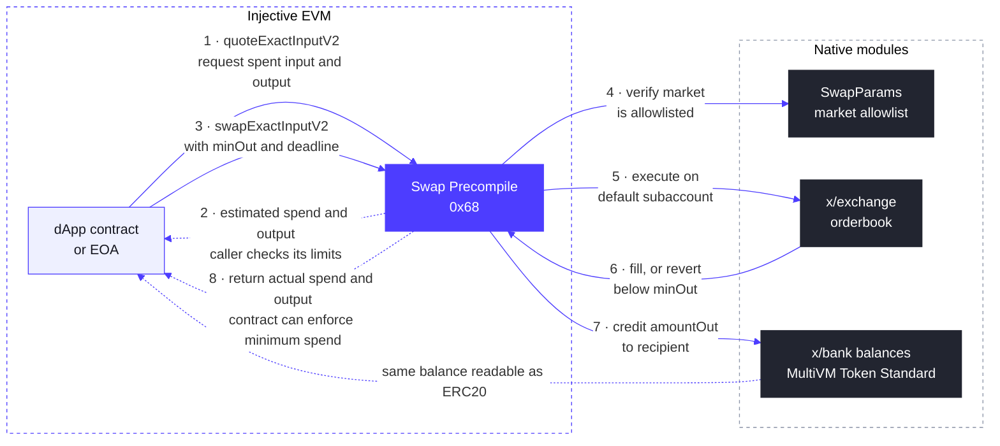

<a id="swap-precompile" />

Injective’s Swap Precompile exposes the native spot exchange to EVM applications at `0x0000000000000000000000000000000000000068`. Use it to read an order-book quote, set a minimum output and deadline, and execute a swap in one call.

<Note>
V1 exact-input methods and `quoteExactOutputV1` are available from v1.20.4. The V2 methods, exact-output execution, and EVM-native MTS token resolution ship in v1.21, including testnet v1.21.0-beta.
</Note>

<a id="create-the-project" />

## Walkthrough

Use the [testnet walkthrough](https://github.com/InjectiveLabs/inj-examples/blob/main/examples/swap-precompile/README.md) to check the allowlist and try quotes and swaps with Viem or Foundry. The [Solidity Contracts localnet demo](https://github.com/InjectiveLabs/solidity-contracts/tree/ea9c54a6af1f922d2d76879c06c6cafc1362a084/demos/swap) seeds a fixed order book so you can reproduce partial fills, quantity rounding, and an exact output swap that reverts at its input cap.

## How it works

1. Select a network and a supported spot market.
2. Resolve the input token and express the amount in its native integer units.
3. Set a minimum output and deadline for exact input, or an input cap and deadline for exact output. Read a fresh quote to check whether the trade meets those limits. If spending a minimum amount matters for an exact input swap, check the quoted V2 spend against that requirement.
4. Simulate the swap from the funded caller. For an exact input swap with a minimum spend requirement, enforce it on the execution result in the calling contract. Submit the transaction and check its receipt.



Quotes read the current order book without changing state. Execution places an atomic spot market order on the caller’s default subaccount and credits the output to the recipient. If the minimum output or deadline check fails, the swap’s state changes revert. Transaction gas can still be charged.

For exact input, `amountIn` is an input budget. Thin liquidity or quantity ticks can leave part of it unspent. The remainder stays with the caller and `minOut` sets the minimum output for the fill. For exact output, execution must deliver at least `amountOut` within `maxAmountIn` or revert. Quantity ticks can cause slightly more output to be delivered.

Orders can change between quoting and execution. Quotes use the undiscounted taker fee, and execution applies the caller’s fee discount and skips paused or frozen makers. A quote-based `minOut` limits deterioration from that quote and may accept a fill the quote already showed as partial. Set an independent minimum output from the worst fee-inclusive price the application accepts when it needs a price bound.

## Swap Precompile Interface

The [Solidity interface](https://github.com/InjectiveLabs/solidity-contracts/blob/ea9c54a6af1f922d2d76879c06c6cafc1362a084/src/Swap.sol) is available at the linked source commit. The node version determines which methods can run.

| Available from | Methods |
| --- | --- |
| v1.20.4 | `quoteExactInputV1`, `swapExactInputV1`, `quoteExactOutputV1` |
| v1.21.0 | `quoteExactInputV2`, `swapExactInputV2`, `swapExactOutputV1` |

```solidity
interface ISwapModule {
    /// Quote the input consumed and output received for an input budget.
    function quoteExactInputV2(
        address tokenIn,
        string calldata marketId,
        uint256 amountIn
    ) external view returns (uint256 amountInSpent, uint256 amountOut);

    /// Execute within minOut and deadline; return spent input and output.
    function swapExactInputV2(
        address tokenIn,
        string calldata marketId,
        uint256 amountIn,
        uint256 minOut,
        address recipient,
        uint256 deadline
    ) external returns (uint256 amountInSpent, uint256 amountOut);

    /// Legacy exact-input quote; returns only output.
    function quoteExactInputV1(
        address tokenIn,
        string calldata marketId,
        uint256 amountIn
    ) external view returns (uint256 amountOut);

    /// Legacy exact-input swap; returns only output.
    function swapExactInputV1(
        address tokenIn,
        string calldata marketId,
        uint256 amountIn,
        uint256 minOut,
        address recipient,
        uint256 deadline
    ) external returns (uint256 amountOut);

    /// Quote the input required to receive the target output.
    function quoteExactOutputV1(
        address tokenOut,
        string calldata marketId,
        uint256 amountOut
    ) external view returns (uint256 amountIn);

    /// Receive at least amountOut while spending at most maxAmountIn.
    function swapExactOutputV1(
        address tokenOut,
        string calldata marketId,
        uint256 amountOut,
        uint256 maxAmountIn,
        address recipient,
        uint256 deadline
    ) external returns (uint256 amountInSpent, uint256 amountOutDelivered);
}
```

- `marketId` is a `0x`-prefixed, 32-byte spot market ID passed as an ABI `string`.
- `tokenIn` selects the input side for exact input. `tokenOut` selects the asset to receive for exact output. Use the zero address for native INJ. Other tokens resolve through a [registered ERC20 pair](/developers-evm/erc20-module) or an EVM-native MTS `erc20:` denom on v1.21.
- Amounts use the token’s smallest units. For example, 10 USDC is `10000000`. Use output units for `minOut` and input units for `maxAmountIn`.
- `recipient` defaults to the caller when set to the zero address. The precompile spends the immediate caller’s bank balance, including when a contract calls it. Invoke it with zero transaction value. ERC20 approval is unnecessary.
- `deadline` is a Unix timestamp in seconds. Set it to zero to disable the time check.

The V1 and V2 suffixes refer to the precompile’s ABI versions. The exchange module versions its protobuf types independently.

When checking a settled swap against the amounts returned by the precompile, allow for a difference of one smallest token unit. Fractional amounts accumulate in the caller’s default subaccount and can affect when a whole unit moves into or out of the bank balance.

## Partial fills and rounding

For a 50 USDC input budget, a thin book might quote 10 USDC spent and then execute at 10 USDC. Both results leave 40 USDC unspent. V1 exact input methods return only output. With V2, compare `amountIn - amountInSpent` against an application-defined `maxUnspent`, in the input token’s smallest units. Check the quote to catch an insufficient fill early, then check the returned spend after execution. Reverting in the calling contract also rolls back the swap.

A fill rounded to the market’s quantity tick can leave input unspent. For a sell, the tick is already in base token units. For a buy, one tick’s cost is the base quantity tick multiplied by the price of the first ask level the swap did not fully use, including the net fee. Express that cost in quote token units before comparing it with the remainder. For example, a 0.001 INJ tick at 10 USDC per INJ and a 0.15% net fee costs 0.010015 USDC. A higher price bound allows a larger remainder and can accept a partial fill. Use an explicit minimum spend if the application needs a strict fill policy.

For a fixed output target, use `swapExactOutputV1` with a `maxAmountIn` the application is willing to spend. The precompile checks the rounded-up exact output quote against this cap. If the quote is 20.030001 USDC and the swap would spend 20.030000 USDC, a cap of 20.030000 USDC still reverts.

## Market allowlist

Swappable markets are governed by `SwapParams`, an enable flag plus a market allowlist inside the exchange module parameters. Calling the precompile on a market that is not allowlisted reverts with:

```text
market <id> is not allowlisted for swaps: invalid swap route
```

### Checking the current allowlist

Choose your network to query the exchange module’s v2 swap parameters.

<Tabs>
<Tab title="Testnet">

```bash
curl -fsS https://testnet.sentry.lcd.injective.network/injective/exchange/v2/exchangeParams \
  | jq '.params.swap_params'
```

</Tab>
<Tab title="Mainnet">

```bash
curl -fsS https://sentry.lcd.injective.network/injective/exchange/v2/exchangeParams \
  | jq '.params.swap_params'
```

</Tab>
</Tabs>

Use `jq '.params.exchange_admins'` to list the exchange admins on the selected network.

### Requesting a market

If you are building on the swap precompile and need a market allowlisted, reach out in the `#developers` channel of the [Injective Discord](https://discord.gg/injective) with the spot market id, or raise it with your Injective partner contact. Market ids for active spot markets are listed at `/injective/exchange/v2/spot/markets?status=Active`.

### Updating the allowlist (exchange admins)

`MsgUpdateSwapParams` is callable by the governance authority or any address in the `exchange_admins` parameter. It takes effect immediately, with no governance vote required when sent by an admin.

The message **fully replaces** the swap parameter group. Always include every market that should remain allowlisted and keep `enabled: true`, because omitting an existing market removes it and omitting the flag pauses all swaps.

```json
{
  "body": {
    "messages": [
      {
        "@type": "/injective.exchange.v2.MsgUpdateSwapParams",
        "sender": "<admin inj1... address>",
        "swap_params": {
          "enabled": true,
          "allowed_markets": ["0x<existing market id>", "0x<new market id>"]
        }
      }
    ]
  },
  "auth_info": {
    "fee": {
      "amount": [{ "denom": "inj", "amount": "200000000000000" }],
      "gas_limit": "400000"
    }
  }
}
```

Sign and broadcast the transaction document with `injectived tx sign` and `injectived tx broadcast` from the admin key.
