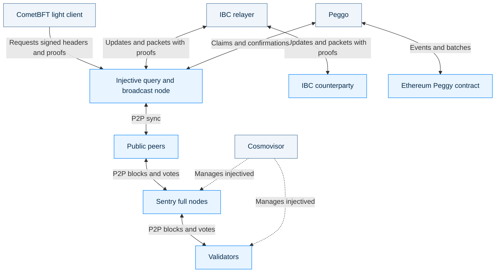
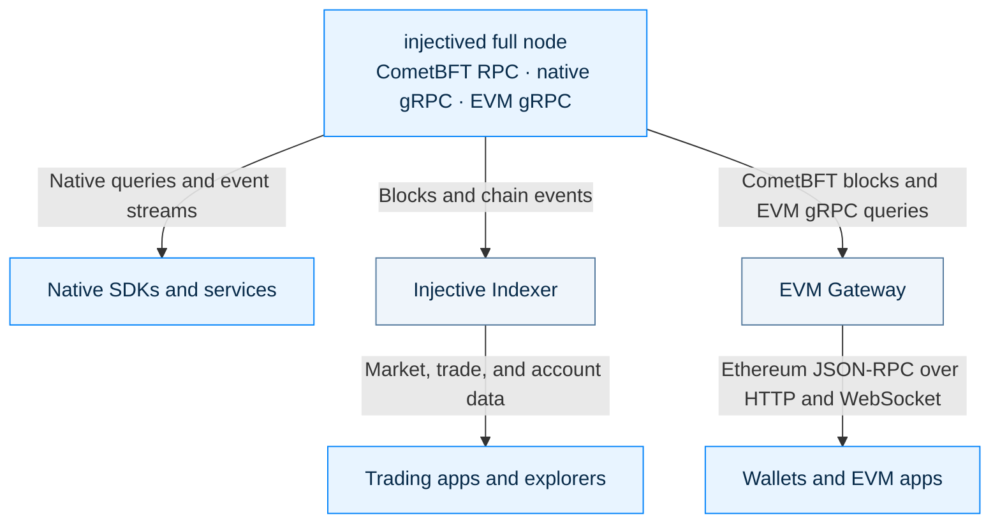

Injective nodes run `injectived`, the Injective Core executable. As a node daemon, it runs Injective’s native execution modules and the EVM, and uses CometBFT for peer networking and consensus. The same executable provides command line tools for querying chain state and submitting transactions. See [Install the Mainnet release](/infra/run-node#install-the-mainnet-release) for node binaries.

Validators are nodes that help secure Injective by bonding native INJ and proposing and voting on blocks. Their voting power reflects their bonded stake, including INJ delegated to them. CometBFT commits a block once validators representing more than two thirds of voting power precommit to it. This gives committed blocks subsecond finality under normal network conditions. Sentries carry peer traffic for validators, relayers submit cross chain messages, and API services provide access to chain data.

## Consensus and relay paths

This diagram shows a validator behind sentry peers. Operators can use separate full nodes for public queries and transaction submission.

### Validators, sentries, and light clients

- **Validators** are bonded consensus participants. They run `injectived`, validate blocks, and use validator keys to sign proposals and votes. See [Validator Setup](/infra/validator-mainnet).
- **Sentries** are full nodes that peer with a validator and the wider network so the validator can keep its peer address and RPC private. They verify blocks and relay peer traffic. A full node can prune historical state and still validate new blocks. An archival node keeps historical state for queries and backfill. See [Run a Mainnet Node](/infra/run-node), [Hardware Requirements](/infra/hardware), and [Archival Setup](/infra/archival-setup).
- **CometBFT light clients** verify signed headers from a trusted starting point and use verified headers to check application state proofs. They can query a full node without executing every transaction or storing the complete chain state. IBC uses this verification through its `07-tendermint` light client. A counterparty chain uses that client to verify Injective headers and check proofs for packets and acknowledgements. See [CometBFT](https://github.com/cometbft/cometbft) and [IBC Go](https://github.com/cosmos/ibc-go).
- **Cosmovisor** is an optional process manager that automatically polls `$DAEMON_HOME/data/upgrade-info.json` for an upgrade signal. At the scheduled height, `injectived` writes the upgrade plan to that file. Cosmovisor then switches to the prepared binary and restarts the node if `DAEMON_RESTART_AFTER_UPGRADE` is enabled, as it is by default. See [Cosmovisor setup](/infra/cosmovisor) and [Cosmovisor v1.5.0](https://github.com/cosmos/cosmos-sdk/tree/tools/cosmovisor/v1.5.0/tools/cosmovisor).

### IBC relayers and Peggo

- **IBC relayers** watch both chains, pay gas, and submit client updates, packet proofs, acknowledgements, and timeouts. Each receiving chain uses its onchain IBC light client of the counterparty to verify the proofs. See [Hermes](https://github.com/informalsystems/hermes), [IBC Go](https://github.com/cosmos/ibc-go), and the [IBC precompile reference](/developers-evm/ibc-precompile).
- **Peggo** is the separate orchestrator for the Peggy bridge between Injective and Ethereum. It observes Ethereum bridge events, submits claims and confirmations to Injective, and relays validator set updates and withdrawal batches to the Ethereum contract. See [Peggo setup](/infra/validator-mainnet/peggo), the [Peggy module](/developers-native/injective/peggy), and [Peggo releases](https://github.com/InjectiveFoundation/injective-core/releases).

## How applications read the chain

Use native query endpoints for current chain state, the indexer for indexed market and transaction history, and the EVM Gateway for Ethereum JSON-RPC. Each service can use its own upstream full node.

- **Built-in EVM gRPC** is the `injective.evm.v1.Query` service inside `injectived`. It provides EVM state queries and simulation methods such as `EthCall` and `EstimateGas` to gRPC clients, including EVM Gateway. See the [EVM query definitions](https://github.com/InjectiveLabs/injective-proto/blob/master/all_protos/injective/evm/v1/query.proto).
- **EVM Gateway** runs separately from `injectived`. It reads CometBFT block data and uses native gRPC queries, builds a local index of EVM blocks, transactions, receipts, and logs, and serves Ethereum JSON-RPC. See the [EVM Gateway explainer](/developers-evm/evm-gateway) and [Gateway source](https://github.com/InjectiveLabs/evm-gateway).
- **Injective Indexer** processes chain events into queryable records for markets, orders, fills, and account activity. See [Query Indexer](/developers-native/query-indexer), [Indexer API architecture](/developers/concepts/indexer-api), and the [Indexer repository](https://github.com/InjectiveLabs/injective-indexer), which requires repository access.

<Warning>
Use Injective Core’s optional built-in Ethereum JSON-RPC server for local development and testing only. [EVM Gateway](/developers-evm/evm-gateway) is the recommended Ethereum JSON-RPC server for production.
</Warning>

For service addresses, see [Mainnet Public Endpoints](/infra/public-endpoints) and [Testnet Public Endpoints](/testnet/public-endpoints).
